<h1 align="center">Product Aesthetics</h1>

<p align="center"><b>A hand-picked collection of beautiful, free design tools.</b><br>
Fonts, icons, photos, sound, voices, video, animation, charts, maps and 3D,<br>
free to use in anything you make, with no credit to anyone.</p>

<p align="center">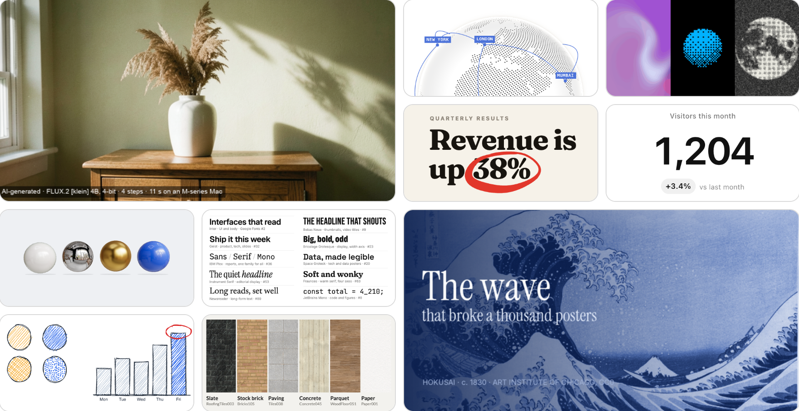</p>

<p align="center">
<a href="#what-this-is">What this is</a> ·
<a href="#how-to-use-it">How to use it</a> ·
<a href="#the-catalogue">The catalogue</a> ·
<a href="#is-it-really-free">Is it really free?</a> ·
<a href="#for-developers">For developers</a>
</p>

## What this is

Making something look good usually means hours on stock sites, free trials and "free for personal use only" small print. This collection does that digging for you. It's a shelf of the best free design tools and materials around, and every one was checked by hand.

Everything here passed three tests:

- **It looks exceptional.** It's good enough to make a designer stop scrolling. Merely decent doesn't get in.
- **It's free, with no credit.** You can use it for work and for things you sell, and you never have to put anyone's name on what you make.
- **It's looked after.** Someone still maintains it, or it's finished and millions of people rely on it.

Each one has its own page with a picture of it working, what it's good for and how to get it.

## How to use it

**1. Browse.** Scroll down to [the catalogue](#the-catalogue). Every picture shows the real thing working, not a mock-up.

**2. Open its page.** Click a picture. The page says what it's for and gives the full steps to get it.

**3. Get it.** The label under each one tells you what that involves:

| Label | What it is | How you get it |
|---|---|---|
| **Download and use** | Fonts, photos, sound effects and textures | Follow the link on its page and download what you need. There's no sign-up and no fee. |
| **Runs on your computer** | Free software, from a 3D studio to a voiceover maker | Most are set up by typing a few commands. The easy way is to ask Claude to do it for you. |
| **For websites and apps** | Building blocks that websites are made from | Ask whoever builds your website, or Claude, to add it. |

Some also say **Matches your brand**. Those can redraw themselves in your own colours and fonts ([see how](#make-it-match-your-brand)).

### Or just ask Claude

You don't need to know how any of this works. If you use Claude (for example Claude Code on your computer), paste in the link to this page, then say what you're making. For example:

```text
Add the spinning globe from this collection to our website, in our brand colours.
```

```text
Set up Kokoro from this collection, then read my script aloud in a British voice.
```

```text
Find me free sound effects for a page turn and a whoosh in this collection.
```

Claude reads the same pages you do and follows the steps on them.

## The catalogue

<!-- catalogue:start (pa check --fix writes this) -->

31 picks in 8 sections. Click any picture to open its page.

**Jump to:** [Type and icons](#type-and-icons) · [Photos and pictures](#photos-and-pictures) · [Hand-drawn](#hand-drawn) · [Charts and maps](#charts-and-maps) · [Backgrounds, textures and 3D](#backgrounds-textures-and-3d) · [Animation](#animation) · [Video](#video) · [Sound and voice](#sound-and-voice)

### Type and icons

The letters and symbols everything else is built from.

<table>
<tr>
<td width="50%" valign="top"><a href="catalogue/open-fonts">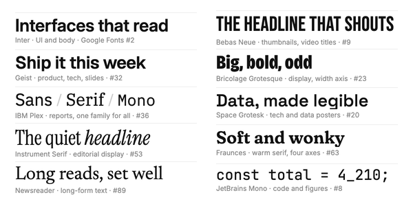</a><br><b><a href="catalogue/open-fonts">Open fonts kit</a></b><br>Nineteen of the best free typefaces, hand-picked: clean ones for everyday text, bold and narrow ones for headlines, elegant serifs, steady ones for numbers and tables, and one that looks handwritten.<br><sub>DOWNLOAD AND USE</sub></td>
<td width="50%" valign="top"><a href="catalogue/iconify">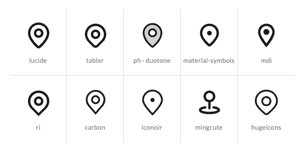</a><br><b><a href="catalogue/iconify">Iconify</a></b><br>Over 200 icon sets in one place, from simple outlines to bold filled shapes. 159 of the sets need no credit, and its page lists which.<br><sub>FOR WEBSITES AND APPS</sub></td>
</tr>
</table>

### Photos and pictures

Real art and photography, AI images, and tools that edit pictures in bulk.

<table>
<tr>
<td width="50%" valign="top"><a href="catalogue/public-domain-images">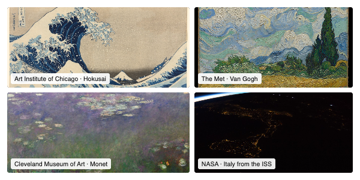</a><br><b><a href="catalogue/public-domain-images">Public-domain image archives</a></b><br>Hundreds of thousands of famous paintings, prints and NASA space photos, free to use with no credit: real art and real photography instead of stock images.<br><sub>DOWNLOAD AND USE</sub></td>
<td width="50%" valign="top"><a href="catalogue/flux-klein">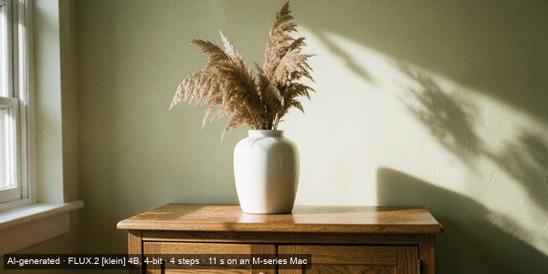</a><br><b><a href="catalogue/flux-klein">FLUX.2 [klein] 4B</a></b><br>Makes a realistic image from a written description, or edits a real photo, on your own laptop in about ten seconds. Free for commercial use, with no credit.<br><sub>RUNS ON YOUR COMPUTER</sub></td>
</tr>
<tr>
<td width="50%" valign="top"><a href="catalogue/opencv">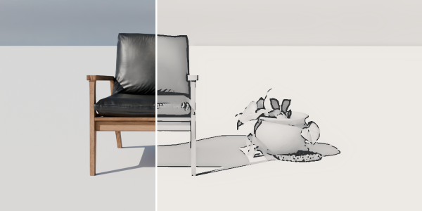</a><br><b><a href="catalogue/opencv">OpenCV</a></b><br>Clever photo effects done automatically: turn a photo into a pencil sketch, cut out the subject, or straighten a shot taken at an angle.<br><sub>RUNS ON YOUR COMPUTER</sub></td>
<td width="50%" valign="top"><a href="catalogue/pillow">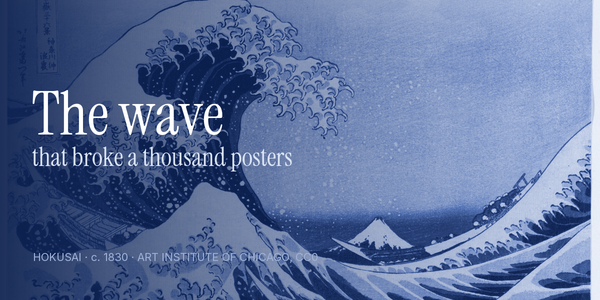</a><br><b><a href="catalogue/pillow">Pillow</a></b><br>Crops, resizes, recolours and adds text to images automatically, so a hundred social cards or thumbnails take the same effort as one.<br><sub>RUNS ON YOUR COMPUTER</sub></td>
</tr>
</table>

### Hand-drawn

A human touch: shapes that look sketched and strokes that look inked.

<table>
<tr>
<td width="50%" valign="top"><a href="catalogue/perfect-freehand">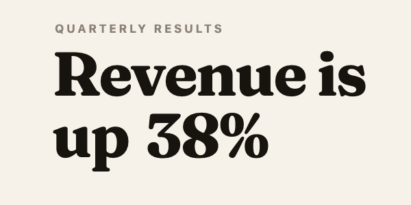</a><br><b><a href="catalogue/perfect-freehand">perfect-freehand</a></b><br>Ink strokes that taper and thicken like a real pen, for circling, underlining and scribbling on top of a design.<br><sub>FOR WEBSITES AND APPS</sub></td>
<td width="50%" valign="top"><a href="catalogue/roughjs">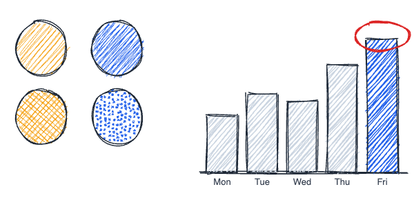</a><br><b><a href="catalogue/roughjs">Rough.js</a></b><br>Makes shapes and charts look sketched by hand, with pencil-style shading. It gives the popular whiteboard app Excalidraw its look.<br><sub>FOR WEBSITES AND APPS</sub></td>
</tr>
</table>

### Charts and maps

For making numbers and places easy to see at a glance.

<table>
<tr>
<td width="50%" valign="top"><a href="catalogue/datatype">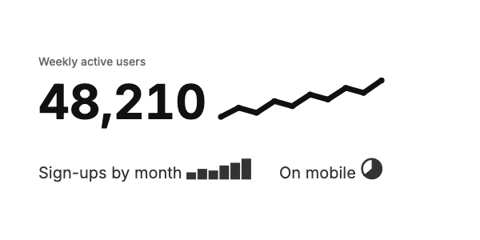</a><br><b><a href="catalogue/datatype">Datatype</a></b><br>A font that draws tiny charts inside a sentence: type numbers in a short code and a trend line, bar chart or pie appears among the words.<br><sub>DOWNLOAD AND USE</sub></td>
<td width="50%" valign="top"><a href="catalogue/geopandas">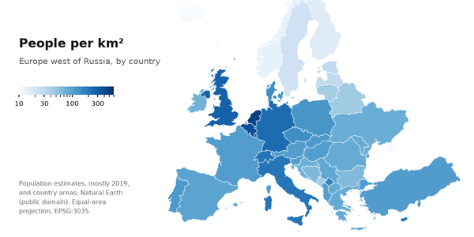</a><br><b><a href="catalogue/geopandas">GeoPandas</a></b><br>Turns figures into maps drawn on real boundaries, such as countries, regions or local areas, shaded by the numbers.<br><sub>RUNS ON YOUR COMPUTER</sub></td>
</tr>
<tr>
<td width="50%" valign="top"><a href="catalogue/cobe">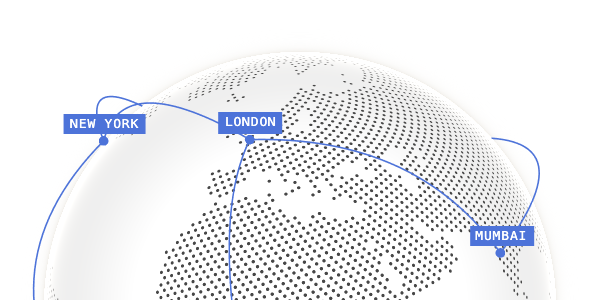</a><br><b><a href="catalogue/cobe">cobe</a></b><br>A dotted globe that spins, with markers on cities and arcs flying between them, small and fast enough for any web page.<br><sub>FOR WEBSITES AND APPS · MATCHES YOUR BRAND</sub></td>
<td width="50%" valign="top"><a href="catalogue/d3">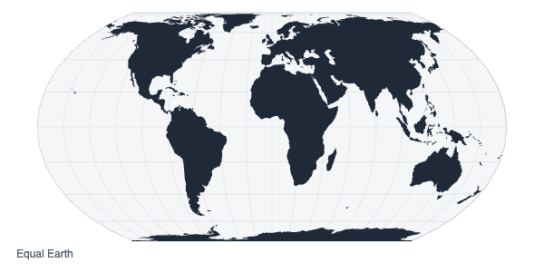</a><br><b><a href="catalogue/d3">D3</a></b><br>The toolkit behind many of the best data graphics in newspapers and journals, for charts and maps no ready-made tool would draw.<br><sub>FOR WEBSITES AND APPS</sub></td>
</tr>
<tr>
<td width="50%" valign="top"><a href="catalogue/observable-plot">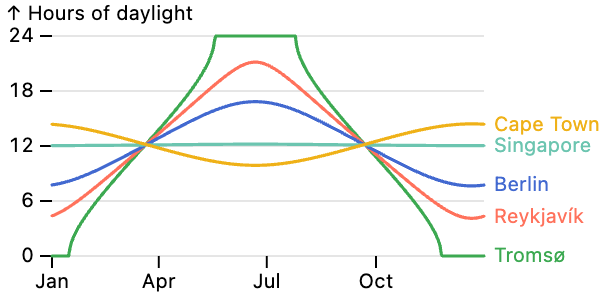</a><br><b><a href="catalogue/observable-plot">Observable Plot</a></b><br>Clean charts in the style of a good newspaper: quiet gridlines, labels right next to the lines, nothing extra.<br><sub>FOR WEBSITES AND APPS · MATCHES YOUR BRAND</sub></td>
<td width="50%" valign="top"><a href="catalogue/vizzu">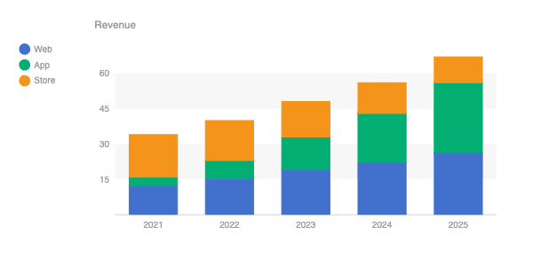</a><br><b><a href="catalogue/vizzu">Vizzu</a></b><br>Charts that change shape in front of the viewer: bars regroup, curl into a pie, then pour into layers, so people can follow the story.<br><sub>FOR WEBSITES AND APPS · MATCHES YOUR BRAND</sub></td>
</tr>
</table>

### Backgrounds, textures and 3D

Surfaces, light and depth, from a slow-moving colour wash to a 3D scene that looks like a photo.

<table>
<tr>
<td width="50%" valign="top"><a href="catalogue/ambientcg">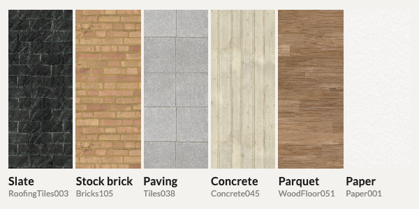</a><br><b><a href="catalogue/ambientcg">ambientCG</a></b><br>2,900 free surface textures, from brick, slate and concrete to marble, wood and paper, for 3D scenes or as backgrounds.<br><sub>DOWNLOAD AND USE</sub></td>
<td width="50%" valign="top"><a href="catalogue/poly-haven">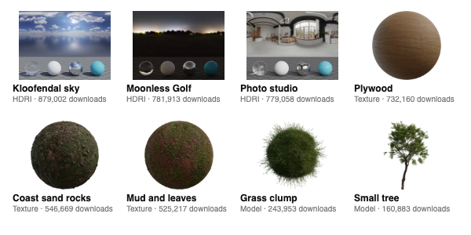</a><br><b><a href="catalogue/poly-haven">Poly Haven</a></b><br>About 2,400 free skies, surfaces and 3D objects, photographed and scanned from the real thing, which make a 3D scene look like a photo.<br><sub>DOWNLOAD AND USE</sub></td>
</tr>
<tr>
<td width="50%" valign="top"><a href="catalogue/blender">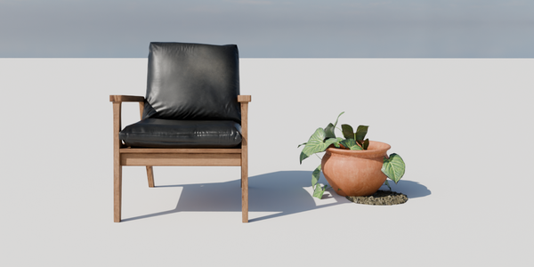</a><br><b><a href="catalogue/blender">Blender</a></b><br>A complete free 3D studio: build objects and scenes, render them as realistic as a photo, animate them and edit the video.<br><sub>RUNS ON YOUR COMPUTER</sub></td>
<td width="50%" valign="top"><a href="catalogue/paper-shaders">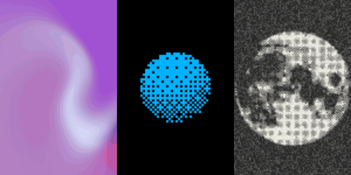</a><br><b><a href="catalogue/paper-shaders">Paper Shaders</a></b><br>Thirty ready-made moving backgrounds and photo effects: soft colour washes, film grain, retro dot patterns and paper textures.<br><sub>FOR WEBSITES AND APPS · MATCHES YOUR BRAND</sub></td>
</tr>
<tr>
<td width="50%" valign="top"><a href="catalogue/three">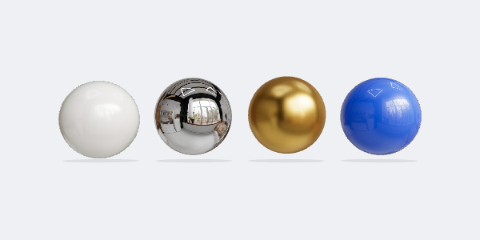</a><br><b><a href="catalogue/three">three.js</a></b><br>Real 3D on a web page: objects with lifelike materials and lighting that visitors can turn around, or that can be filmed for a video.<br><sub>FOR WEBSITES AND APPS</sub></td>
<td width="50%"></td>
</tr>
</table>

### Animation

Movement for websites and apps, from quiet polish to headlines that grab attention.

<table>
<tr>
<td width="50%" valign="top"><a href="catalogue/animejs"></a><br><b><a href="catalogue/animejs">anime.js</a></b><br>Lines that draw themselves, headlines that build letter by letter, and whole sequences timed to the millisecond.<br><sub>FOR WEBSITES AND APPS</sub></td>
<td width="50%" valign="top"><a href="catalogue/fancy-components">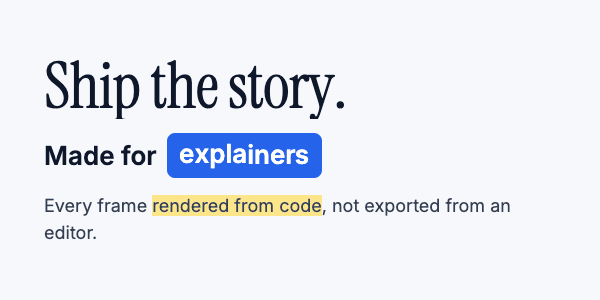</a><br><b><a href="catalogue/fancy-components">Fancy Components</a></b><br>Headline type that moves: letters slice into place, words swap inside a highlighted pill, and headlines tumble and pile up as if under gravity.<br><sub>FOR WEBSITES AND APPS</sub></td>
</tr>
<tr>
<td width="50%" valign="top"><a href="catalogue/motion">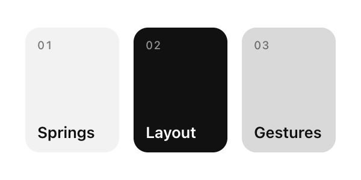</a><br><b><a href="catalogue/motion">Motion</a></b><br>Gives a website natural, springy movement: cards that grow into full pages, panels that glide in and out, buttons that respond to a tap.<br><sub>FOR WEBSITES AND APPS</sub></td>
<td width="50%" valign="top"><a href="catalogue/motion-primitives">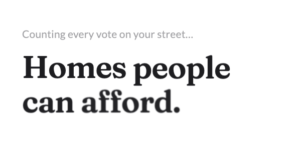</a><br><b><a href="catalogue/motion-primitives">Motion Primitives</a></b><br>Quiet, polished movement for websites: shimmering text, soft blur-ins, glowing borders, and windows that open smoothly out of a button.<br><sub>FOR WEBSITES AND APPS</sub></td>
</tr>
<tr>
<td width="50%" valign="top"><a href="catalogue/number-flow">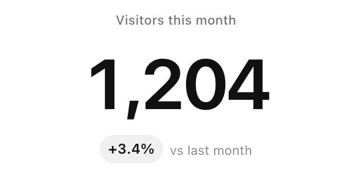</a><br><b><a href="catalogue/number-flow">NumberFlow</a></b><br>Numbers that roll to their new value digit by digit, like a departures board, in any currency or format.<br><sub>FOR WEBSITES AND APPS</sub></td>
<td width="50%" valign="top"><a href="catalogue/thinking-orbs">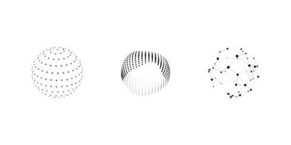</a><br><b><a href="catalogue/thinking-orbs">Thinking Orbs</a></b><br>Small dotted spheres that show what an AI assistant is doing: nine moods, such as searching, listening and solving, each with its own movement.<br><sub>FOR WEBSITES AND APPS · MATCHES YOUR BRAND</sub></td>
</tr>
</table>

### Video

The machinery that turns a design into a finished video.

<table>
<tr>
<td width="50%" valign="top"><a href="catalogue/ffmpeg">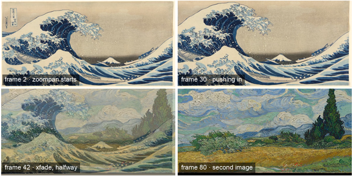</a><br><b><a href="catalogue/ffmpeg">FFmpeg</a></b><br>The engine inside nearly every video tool: it cuts, joins, zooms, puts music under a voice, adds captions and makes GIFs.<br><sub>RUNS ON YOUR COMPUTER</sub></td>
<td width="50%" valign="top"><a href="catalogue/playwright">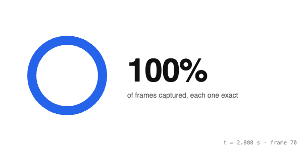</a><br><b><a href="catalogue/playwright">Playwright</a></b><br>Films a web page: anything designed for a browser can be recorded frame by frame as video, or saved as an image or PDF.<br><sub>RUNS ON YOUR COMPUTER</sub></td>
</tr>
</table>

### Sound and voice

Everything a video needs to sound professional: sound effects, a voiceover, a clean recording and captions in time.

<table>
<tr>
<td width="50%" valign="top"><a href="catalogue/freesound-cc0">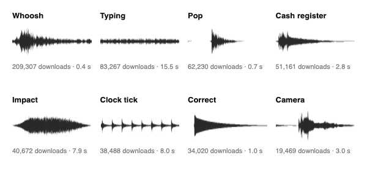</a><br><b><a href="catalogue/freesound-cc0">Freesound CC0 sound kit</a></b><br>The sound effects videos use most: whooshes, pops, clicks, typing, page turns, a ticking clock and more. Twenty-one of the most-downloaded free sounds, one for each job.<br><sub>DOWNLOAD AND USE</sub></td>
<td width="50%" valign="top"><a href="catalogue/deepfilternet">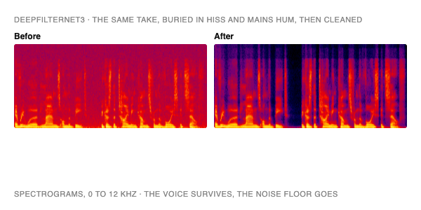</a><br><b><a href="catalogue/deepfilternet">DeepFilterNet</a></b><br>Cleans up a voice recording: it takes out hiss, hum and room noise and leaves the voice sounding natural, so a phone recording can pass for a studio one.<br><sub>RUNS ON YOUR COMPUTER</sub></td>
</tr>
<tr>
<td width="50%" valign="top"><a href="catalogue/faster-whisper">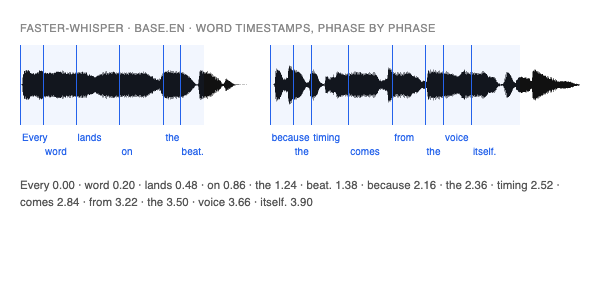</a><br><b><a href="catalogue/faster-whisper">faster-whisper</a></b><br>Writes down every word in a recording with the exact moment it's said, which is what makes captions land right on the voice.<br><sub>RUNS ON YOUR COMPUTER</sub></td>
<td width="50%" valign="top"><a href="catalogue/kokoro">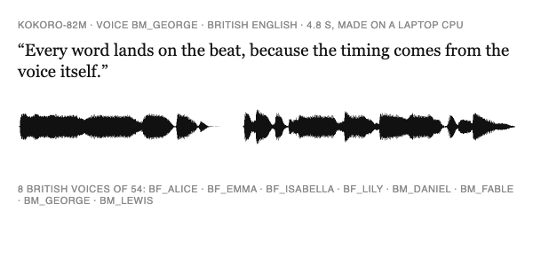</a><br><b><a href="catalogue/kokoro">Kokoro</a></b><br>Turns a script into a natural-sounding voiceover on your own laptop, offline and free: 54 voices in nine languages, eight of them British.<br><sub>RUNS ON YOUR COMPUTER</sub></td>
</tr>
</table>

<!-- catalogue:end -->

## Make it match your brand

Entries labelled **Matches your brand** can redraw themselves in your organisation's colours and fonts. Give Claude your style guide, whether that's a PDF, a link to your website or the colour list your designer uses, and ask for the entry in your brand. Your colours are used exactly as you give them; nothing gets "improved".

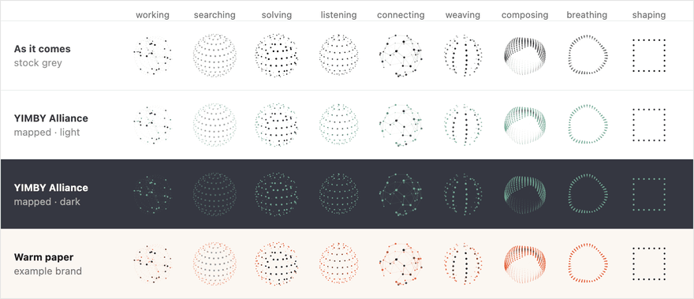

<sub>Thinking Orbs as they come (top row), then the same animations matched to two example brands, on light and dark pages.</sub>

## Is it really free?

Yes. Everything here is free to use in personal projects, at work and in things you sell. You never have to write "photo by", "made with" or anyone's name on what you make.

There are three pieces of small print, and none of them puts anything on screen:

- **Building blocks for websites** come with a short licence file tucked inside the code. Visitors never see it. It's added automatically when your developer or Claude installs the block; just don't delete it.
- **Software you run**, such as Blender, has a licence that covers the software itself. Whatever you make with it is entirely yours.
- **A few pages carry a specific note.** For example, Iconify holds over 200 icon sets, but only 159 of them are credit-free, and its page lists which. Read the Notes at the bottom of a page before you publish.

Some things are left out on purpose: anything that asks for a visible credit, bans commercial use, needs a paid account, or is a free taster for a paid product.

**Checked, not assumed.** Every licence here was read in full, not taken from a badge, and each page records which version was checked and when. Projects sometimes change their terms, so a built-in check re-reads every licence and flags any change.

## For developers

Everything above is for people who make things. This part is for people who write code. It covers the `pa` command-line tool, brand files and how to add a library.

<details>
<summary><b>Install and use <code>pa</code></b></summary>

You need Node 22 or later.

```bash
git clone https://github.com/j-a-m-e-s-g/product-aesthetics.git
cd product-aesthetics && npm link                  # optional: puts `pa` on your PATH

cd ~/your-app
pa list                                            # what's in the catalogue
pa add thinking-orbs                               # install it as it comes
pa add thinking-orbs --brand src/app/globals.css   # …or generated in your brand
```

Without `npm link`, run `node <path to>/product-aesthetics/bin/pa.mjs` in place of `pa`.

`pa add` installs with your project's package manager (pnpm, bun, yarn or npm, picked from the lockfile). With `--brand` it also writes a ready-made component into `src/components/` (or `--out <dir>`), and prints how to use it. It won't overwrite a file unless you add `--force`. Every library's own folder has the full install and usage steps if you'd rather do it by hand.

</details>

<details>
<summary><b>Brand files: how <code>--brand</code> reads your style guide</b></summary>

Nothing in this repo belongs to any one brand. Your style guide stays in your own project, and `--brand` reads it from there. The adapters work from eight colour roles, three font stacks and a radius. Point `--brand` at either of these:

**Your app's CSS.** If the project uses shadcn/ui or Tailwind v4, its `globals.css` already holds a style guide. `pa` reads `--background`, `--foreground`, `--primary`, `--color-*`, `--font-sans`, `--radius` and the rest from `:root`, `@theme` and `.dark`. It handles hex, `rgb()`, `hsl()`, `oklch()` and shadcn's bare HSL values, and it follows `var()` references.

**A brand file.** Keep a small JSON file in your project, shaped like the examples in [`brands/`](brands/). If your style guide is a PDF, a Figma file or a web page, ask Claude to write this file from it:

```json
{
  "name": "Example (cool slate)",
  "colors": { "background": "#F6F8FB", "foreground": "#0F172A", "primary": "#2563EB", "accent": "#0891B2" },
  "dark":   { "background": "#0B1220", "foreground": "#E2E8F0", "primary": "#60A5FA" },
  "fonts":  { "sans": "Inter", "mono": "JetBrains Mono" },
  "radius": "8px"
}
```

Only `background`, `foreground` and `primary` are required. `pa` works out the rest and doesn't change any colour you give it:

| Role | If you leave it out |
|---|---|
| `primaryForeground` | whichever of background or foreground reads better on primary |
| `accent` | primary |
| `muted`, `border` | the background tinted 6% and 13% toward the foreground (mixed in OKLab, so tints stay clean) |
| `mutedForeground` | foreground eased 38% toward the background, but never under 4.5:1 contrast |
| the whole `dark` scheme | background and foreground swapped; primary lightened only if it falls under 3:1 on the dark background |
| `fonts` | `"Inter"` becomes `"Inter", system-ui, sans-serif`; display follows sans; mono falls back to the system mono |

Design-token files in the W3C format (`{"$value": …}`) load as they are, and keys can be `primary-foreground` or `primaryForeground`.

`pa brand <file>` prints what a brand resolves to, with colour swatches, and warns when contrast is weak:

```text
$ pa brand brands/example-cool.json
Example (cool slate) from brands/example-cool.json
  background         #f6f8fb    #0b1220
  foreground         #0f172a    #e2e8f0
  primary            #2563eb    #60a5fa
  accent             #0891b2    #22d3ee
  …
```

</details>

<details>
<summary><b>The licence rules <code>pa check</code> enforces</b></summary>

| Terms | Licences | What you owe |
|---|---|---|
| **no strings** | CC0-1.0, Unlicense, MIT-0, 0BSD, public domain mark | nothing |
| **keep notice** | MIT, ISC, BSD-2/3-Clause, Apache-2.0, OFL-1.1 | nothing on screen; the licence text stays with the code. npm keeps it in `node_modules` for you, and copy-pasted files keep their header comment |

Apps we run rather than ship (`"kind": "tool"`) are the exception: any open-source licence is fine, because it covers the app, not what we make with it.

**Kept out of anything we ship:** GPL, LGPL and AGPL (copyleft); any CC-BY (visible credit) or non-commercial licence; MIT plus Commons Clause; BSL, PolyForm and other source-available licences; "free with attribution"; and anything that's free only as a teaser for a paid tier.

**Alive:** archived repos are rejected, and a repo with no push for 18 months gets flagged unless its entry says why it's finished rather than abandoned (`settled`).

A project can change its licence for future versions, but the version you installed keeps the licence it shipped under. That's why each entry records the version and the date its licence was read. `pa check --online` re-reads every licence on GitHub and npm and fails if one has changed.

</details>

<details>
<summary><b>Add a library</b></summary>

The quickest way is to ask Claude: *"add `<repo url>` to product-aesthetics"*. [`CLAUDE.md`](CLAUDE.md) holds the checklist it follows.

You can also keep a checklist of candidates, in a Google Doc or any Markdown file, and tick the ones you want. `pa picks <file>` reads the ticks (from the Markdown export, for a Google Doc) and lists what isn't in the catalogue yet, so Claude can add exactly those.

To do it by hand:

1. Read the licence yourself, including the LICENSE file and the README's small print. Don't go by the badge.
2. Create `catalogue/<id>/` with:
   - `entry.json`: the facts (see below)
   - `README.md`: install, usage and how it takes your brand ([thinking-orbs](catalogue/thinking-orbs/README.md) is the model)
   - `preview.gif`: a 600 × 300 tile rendered from the real library, under 500 KB
   - `adapter.mjs`, if it takes colours, fonts or radius
3. Run `npm test`, then `node bin/pa.mjs check --online --fix`. The check validates the entry, runs its adapter against both example brands, re-reads the licence upstream and rewrites the catalogue above.

```jsonc
{
  "name": "Thinking Orbs",
  "tagline": "One plain sentence a non-coder understands: what it does for them.",
  "category": "Animation",                  // one of the sections in lib/catalogue.mjs (CATEGORIES)
  "author": "Jakub Antalik",
  "github": "Jakubantalik/Libraries.dev",   // owner/repo
  "path": "packages/thinking-orbs",         // optional: a monorepo package
  "demo": "https://libraries.dev/orbs",     // optional
  "licence": "MIT",                         // SPDX id, from the list above
  "stack": ["React"],
  "install": "npm install thinking-orbs",   // shown to people; any command or download step
  "npm": "thinking-orbs",                   // optional: lets pa install it and track versions
  "version": "0.3.2",                       // the version the licence was read at
  "verified": "2026-10-15",                 // the day it was read
  "maps": ["colours"],                      // what the adapter maps: colours, fonts, radius
  "kind": "code",                           // optional: code (default), asset (fonts, icons, images) or tool (an app)
  "url": "https://…",                       // optional: home page, instead of github, for assets and tools
  "settled": "…"                            // optional: why a repo idle for 18+ months is finished, not abandoned
}
```

An adapter is one function. It takes the resolved brand and returns the files to write:

```js
export default async function adapt(brand, { ts, colour }) {
  // brand.light / brand.dark: background, foreground, primary, primaryForeground,
  //   accent, muted, mutedForeground, border (all hex)
  // brand.fonts: sans, display, mono · brand.radius · brand.hasDark
  // colour: mix, deltaE, contrast, ensureContrast, hex, rgba, rgb255 · ts: the project uses TypeScript
  return {
    files: { 'brand-orb.js': '…', 'brand-orb.d.ts': '…' },
    usage: "import { BrandOrb } from '{{dir}}/brand-orb';",
  };
}
```

</details>

<details>
<summary><b>How the repo is laid out</b></summary>

```text
bin/pa.mjs            the CLI (no dependencies)
lib/catalogue.mjs     loads and validates entries; its sections and the catalogue above
lib/brand.mjs         reads brand files and CSS, derives the missing roles
lib/colour.mjs        colour parsing, OKLab mixing, WCAG contrast
lib/picks.mjs         reads the ticks from the Google Doc's Markdown export
test/pa.test.mjs      regression tests for the above and every adapter (npm test)
brands/               two neutral example brands: example.json (warm paper), example-cool.json (cool slate, with a dark scheme)
catalogue/<id>/       one folder per entry: entry.json, README.md, preview, adapter
assets/cover.png      the collage at the top of this page
```

</details>
