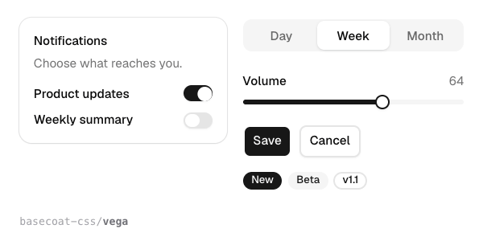

# Basecoat

The shadcn/ui look without React. Basecoat is the same calm, precise component set (buttons, inputs, switches, tabs, cards, dialogs, menus, toasts, a sidebar) written as plain HTML classes, with a few small scripts for the parts that open and close. It works in any stack that outputs HTML: a static page, Rails, Django, Laravel, Hugo, an HTMX app. It ships eight style packs from the current shadcn registry (Vega, Nova, Maia, Lyra, Mira, Luma, Sera, Rhea), and it reads shadcn's theme variables, so any shadcn theme restyles it.



| | |
|---|---|
| **By** | Ronan Berder (hunvreus) |
| **Demo** | [basecoatui.com](https://basecoatui.com) |
| **Source** | [hunvreus/basecoat](https://github.com/hunvreus/basecoat) |
| **Licence** | MIT (keep notice): no visible credit; the licence stays inside `node_modules`. The CDN and bundle files carry no notice of their own, so if you copy them into your repo, keep [LICENSE.md](https://github.com/hunvreus/basecoat/blob/6769c83c9644ec4195ed30af028a9e66fe670215/LICENSE.md) beside them. Covers the CSS, scripts and templates; there's no paid tier. Not covered: the Geist font and Lucide icons the docs use, and Chart.js for the chart helper. All three are free under their own licences (OFL, ISC, MIT). Read on 2026-11-12 at v1.1.0 (commit `6769c83`) |
| **Needs** | Nothing for the CDN files. For the npm route, Tailwind CSS v4 |

## Install

With a Tailwind v4 build:

```bash
npm install basecoat-css       # or: pnpm add basecoat-css · bun add basecoat-css · yarn add basecoat-css
```

```css
/* your main CSS file */
@import "tailwindcss";
@import "basecoat-css";          /* Vega, the default; or basecoat-css/nova, /maia, /lyra, /mira, /luma, /sera, /rhea */
```

```js
import "basecoat-css/all";       // only if you use the interactive parts (see below)
```

With no build step, link the prebuilt files:

```html
<link rel="stylesheet" href="https://cdn.jsdelivr.net/npm/basecoat-css@1.1.0/dist/basecoat.cdn.min.css">
<script src="https://cdn.jsdelivr.net/npm/basecoat-css@1.1.0/dist/js/all.min.js" defer></script>
```

The CDN stylesheet only holds the utilities Basecoat itself uses, so classes like `flex` or `gap-2` in your own markup need Tailwind too (Basecoat's [installation page](https://basecoatui.com/installation) shows how to add the Tailwind Play CDN for prototypes).

## Use it as it comes

A root class plus plain HTML, with `data-variant` and `data-size` for options:

```html
<button class="btn">Save</button>
<button class="btn" data-variant="outline">Cancel</button>

<div class="card">
  <header>
    <h2>Notifications</h2>
    <p>Choose what reaches you.</p>
  </header>
  <section>
    <div role="group" class="field" data-orientation="horizontal">
      <label for="updates">Product updates</label>
      <input type="checkbox" id="updates" role="switch" class="input" checked>
    </div>
  </section>
</div>

<span class="badge" data-variant="secondary">Beta</span>
```

The preview is that markup (with `ms-auto` on each switch to push it right) plus the tabs, slider and badges from the docs, set in Geist (the font Basecoat's tokens ask for; `npm install @fontsource/geist`), rendered once per style pack.

Most components are CSS only. These need the script: accordion, combobox, command, drawer, dropdown menu, popover, select, sidebar, slider, tabs and toast. `all.js` covers them all (44 KB minified); or load `basecoat-css/basecoat` once and then one file per component. Chart is a separate helper that needs Chart.js. Dark mode is `class="dark"` on `<html>`. Nunjucks and Jinja macros for the bigger components (dialog, select, combobox, command, menus, sidebar, tabs, toast) are in `node_modules/basecoat-css/templates/`.

## Use it in your brand

Basecoat reads shadcn/ui's theme variables (`--background`, `--foreground`, `--primary`, `--muted`, `--border`, `--ring`, `--radius` and the rest), so this writes a shadcn theme in your colours, fonts and corner radius:

```bash
cd your-project
pa add basecoat --brand brand.json
# or read the colours straight from your shadcn / Tailwind CSS:
pa add basecoat --brand src/app/globals.css
```

It installs `basecoat-css` and writes `components/brand-theme.css`, with a `:root` block for light pages and a `.dark` block for dark ones. Import it **after** Basecoat:

```css
@import "tailwindcss";
@import "basecoat-css";
@import "./components/brand-theme.css";
```

Without a build, link it after the CDN stylesheet instead: `<link rel="stylesheet" href="/components/brand-theme.css">`.

- **Colours.** Every component follows. Buttons, switches, the slider fill and the default badge take your primary; surfaces your background; text your foreground; hairlines your border. shadcn's `--accent` is a quiet hover tint, not a brand colour, so a strong brand accent goes to the chart colours instead (see `lib/adapters/shadcn-theme.mjs`).
- **Fonts.** Basecoat sets everything in `--font-sans` and code in `--font-mono`. The theme also writes your display font as `--font-heading`, but Basecoat 1.1.0 never uses it, so put it on your own headings. Load the font files yourself.
- **Radius.** Vega, Nova and Mira take your radius. The others have fixed shapes by design: Maia, Luma and Rhea stay soft and pill-shaped, and Lyra and Sera stay square.

Tested on 2026-11-12 with both example brands in this repo. Rendered on Vega in light and dark, the brand's colours and Inter replaced the stock greys and Geist on every component in the preview. On the other seven packs (checked with `example-cool`), the computed button, card and page colours and the font switched to the brand too.

## Notes

- **Version 1.0 changed the class names.** Older tutorials use classes like `btn-primary`; 1.x uses `class="btn" data-variant="primary"`. `@import "basecoat-css/compat";` after Basecoat restores the old names while you migrate.
- **One style pack per page.** Each pack is a complete stylesheet, so import one and don't layer another on top. For your own look, import `basecoat-css/base` and a copy of one pack from `basecoat-css/styles/` to edit.
- **Load order matters.** Put Basecoat after anything that includes Tailwind's reset. A second full Tailwind build loaded after it resets borders and inputs.
- Icons aren't bundled. The docs use inline [Lucide](https://lucide.dev) SVGs (ISC licence), which you paste in yourself.
- Ronan Berder maintains it; the site links to GitHub Sponsors, but nothing is locked behind it.
