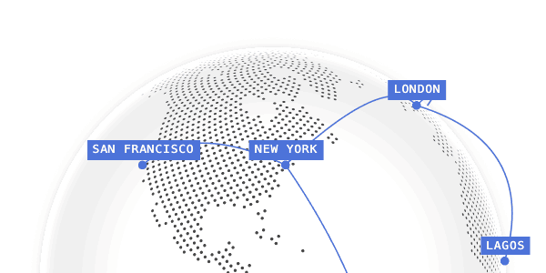
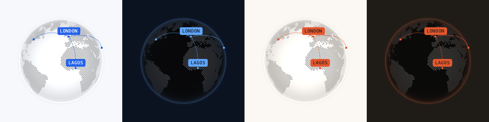

# cobe

A globe made of dots, in 5 KB of WebGL with no dependencies. It spins, takes markers for places and draws arcs between them, and since version 2 it exposes every marker as a CSS anchor, so ordinary HTML labels ride on the globe and fade as they turn away. It's the globe on a lot of product home pages for good reason: one canvas reads as "global" in a hero, a slide, a social card or a few seconds of video. By Shu Ding.



| | |
|---|---|
| **By** | Shu Ding |
| **Demo** | [cobe.vercel.app](https://cobe.vercel.app) (thirteen showcases: stickers, flights, polaroids, weather, bars…) |
| **Source** | [shuding/cobe](https://github.com/shuding/cobe) |
| **Licence** | MIT (keep notice): no visible credit; the licence stays inside `node_modules`. Read on 2026-10-15 at v2.0.1. **The land texture has its own history:** see Notes |
| **Needs** | WebGL. Any JavaScript project; React is optional. Labels need CSS anchor positioning (Chrome and Edge 125+, Safari 26+); without it the globe still works, the labels just don't follow |

## Install

```bash
npm install cobe      # or: pnpm add cobe
```

## Use it as it comes

cobe 2 doesn't run its own loop. Create the globe once, then call `update` with a new `phi` (rotation) every frame. The old `onRender` option that tutorials show was removed in version 2 and is silently ignored, which leaves a globe with no land on it.

```js
import createGlobe from 'cobe';

const globe = createGlobe(canvas, {
  devicePixelRatio: 2, width: 600 * 2, height: 600 * 2,
  phi: 0, theta: 0.2,                 // rotation and tilt, in radians
  dark: 0, diffuse: 1.5, mapSamples: 16000, mapBrightness: 10,
  baseColor: [1, 1, 1], markerColor: [0.3, 0.45, 0.85], glowColor: [0.94, 0.93, 0.91],
  markers: [{ id: 'london', location: [51.51, -0.13], size: 0.03 }],
  arcs: [{ from: [51.51, -0.13], to: [40.71, -74.01] }],
  arcColor: [0.3, 0.45, 0.85], arcWidth: 0.5, arcHeight: 0.25, markerElevation: 0.01,
});

let phi = 0;
(function spin() { phi += 0.005; globe.update({ phi }); requestAnimationFrame(spin); })();
```

Colours are `[r, g, b]` from 0 to 1. `dark: 1` gives a dark globe with lit dots; `mapSamples` sets how many dots (16,000 is the demo's density).

**Labels.** Give a marker an `id` and cobe adds an anchor called `--cobe-<id>`, plus a variable `--cobe-visible-<id>` that's 1 on the near side and 0 behind. The anchors are placed in percentages of the canvas's parent, so wrap the canvas in an element exactly its size and put the labels in there too:

```html
<div style="position: relative; width: 600px; height: 600px">
  <canvas id="globe" style="width: 100%; height: 100%"></canvas>
  <span class="label" style="position: absolute; position-anchor: --cobe-london;
    bottom: anchor(top); left: anchor(center); opacity: var(--cobe-visible-london, 0)">London</span>
</div>
```

**For video and stills.** The globe is a pure function of `phi` and `theta`, so a renderer can step `phi` frame by frame and capture each one; nothing depends on the clock. One full turn is `2 * Math.PI`.

## Use it in your brand

```bash
pa add cobe --brand src/app/globals.css     # or a brand .json
```

This writes three files into `src/components/`:

- `brand-globe.js` (+ `.d.ts`): `brandGlobe.light` and `brandGlobe.dark`, which are cobe's colour props set from your brand, and `spinGlobe(canvas, options)`, which creates the globe and runs the loop for you. It returns `{ globe, stop }`.
- `brand-globe.css`: a `.globe-label` class for the labels, in your primary with your mono font and radius.

```js
import { spinGlobe } from './components/brand-globe';
import './components/brand-globe.css';

const { stop } = spinGlobe(canvas, {
  theme: 'dark',                                 // 'light' (default) or 'dark'
  markers: [{ id: 'london', location: [51.51, -0.13], size: 0.04 }],
  arcs: [{ from: [51.51, -0.13], to: [40.71, -74.01] }],
  speed: 0.004,                                  // radians per frame; 0 holds it still
});
```

| cobe prop | Light | Dark |
|---|---|---|
| `baseColor` | your background, so the globe is the colour of the page | background mixed 35% toward your text colour, which sets how bright the dots are |
| `markerColor`, `arcColor` | primary | dark primary |
| `glowColor` | muted (your background tinted toward the text), a soft halo | dark background mixed 35% toward primary |



<sub>`pa add cobe --brand brands/example-cool.json` (left) and `brands/example.json` (right), light and dark.</sub>

The land dots can't be given a colour of their own: cobe shades them from `baseColor` and `dark`. On a light globe they're always a dark grey, and on a dark globe a light one.

## Notes

- **The land texture.** cobe draws the continents from a small black-and-white image built into the package. Its README credits a Wikimedia Commons map, [World map blank without borders](https://commons.wikimedia.org/wiki/File:World_map_blank_without_borders.svg) (2009), which Commons lists under GFDL and CC BY-SA. cobe ships the derived texture under MIT with no notice. A land-and-sea outline at that resolution is close to pure geographic fact, so there's little in it to protect, but if your legal bar is strict, know that this is the one part of cobe not written by its author.
- The demo site's "Copy prompt" and showcases are worth reading before building anything: the stickers, polaroids and flight-path examples are each a few lines on top of the same API.
- cobe is canvas-only. For a flat dotted map, or a single country, it's the wrong tool.
