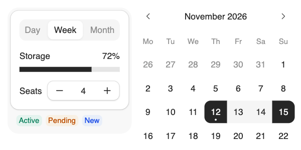

# coss ui

The design system coss.com builds its own product with, formerly Origin UI. Over fifty components on Base UI (buttons, inputs, number fields, segmented controls, meters, calendars, menus, dialogs, toasts, a sidebar) drawn with unusual care: translucent hairline borders, a one-pixel highlight on every raised surface, soft bottom shadows, and spacing that holds up at small sizes. On top sit some 530 "particles", ready-made combinations to copy. Like shadcn/ui it's copy-and-paste through the shadcn CLI, and it reads shadcn's theme variables, so one theme file restyles it.



| | |
|---|---|
| **By** | coss.com (formerly Origin UI) |
| **Demo** | [coss.com/ui](https://coss.com/ui) · [particles](https://coss.com/ui/particles) |
| **Source** | [cosscom/ui › apps/ui](https://github.com/cosscom/ui/tree/main/apps/ui) |
| **Licence** | MIT (keep notice) for the whole repo: no visible credit, but copied files must keep the MIT notice as a comment (see Install). There's no paid tier. The Cal Sans font coss.com itself uses isn't part of the default install. Read on 2026-11-12 at commit `fe6ffa8` |
| **Needs** | React 18 or 19, Tailwind CSS v4, `@base-ui/react`. The default style's font setup assumes Next.js (see Install) |

## Install

In a new project, one command sets up the theme, the fonts (Inter and Geist Mono) and every component:

```bash
npx shadcn@latest init @coss/style          # or: pnpm dlx shadcn@latest init @coss/style
```

In an existing shadcn project, add the same style, or just the components and colours:

```bash
npx shadcn@latest add @coss/style                    # theme, fonts and all components
npx shadcn@latest add @coss/ui @coss/colors-neutral  # components and colours only
npx shadcn@latest add @coss/calendar                 # one component
npx shadcn@latest add @coss/p-calendar-10            # one particle (a ready-made example)
```

The `@coss` namespace is built into the shadcn CLI, so there's nothing to add to `components.json`. Components land in `components/ui/` and install `@base-ui/react`, `lucide-react` and whatever else they use (the calendar brings `@daypicker/react`).

**Outside Next.js**, delete the `@import "geist";` line the style adds to your CSS. `geist` is a `next/font` package with no stylesheet, so the line stops Tailwind building; load Geist Mono another way (for example `@fontsource/geist-mono`) if you want it.

**Keep the MIT notice.** The CLI doesn't add one, so put this at the top of each copied file, and save the licence once next to them:

```tsx
// Based on coss ui (https://coss.com/ui)
// Copyright (c) 2025 coss.com and Origin UI. MIT licence; full text in ./LICENSE
```

```bash
curl -sL https://raw.githubusercontent.com/cosscom/ui/main/LICENSE -o components/ui/LICENSE
```

## Use it as it comes

```tsx
import { Frame, FramePanel } from '@/components/ui/frame';
import { SegmentedControl, SegmentedControlItem } from '@/components/ui/segmented-control';
import { Meter, MeterIndicator, MeterLabel, MeterTrack, MeterValue } from '@/components/ui/meter';
import { Calendar } from '@/components/ui/calendar';

<Frame>
  <FramePanel>
    <SegmentedControl defaultValue="week">
      <SegmentedControlItem value="day">Day</SegmentedControlItem>
      <SegmentedControlItem value="week">Week</SegmentedControlItem>
    </SegmentedControl>
    <Meter value={72}>
      <MeterLabel>Storage</MeterLabel> <MeterValue />
      <MeterTrack><MeterIndicator /></MeterTrack>
    </Meter>
  </FramePanel>
</Frame>

<Calendar mode="range" selected={range} onSelect={setRange} />
```

The preview is the `@coss/style` install unedited: `Frame` holding a `SegmentedControl`, a `Meter`, a `NumberField` and three `Badge`s (`success`, `warning`, `info`), next to a range `Calendar`. It's rendered at desktop width, because many components size down from the `sm` breakpoint (40rem) up; on a phone they're a touch larger, for fingers.

**Components worth knowing:**

| Component | What it does | Good for |
|---|---|---|
| `frame` | a tinted outer tray holding white panels | settings sections, grouped controls |
| `segmented-control`, `toggle-group` | a sliding pill between options | view switches (day, week, month) |
| `number-field` | a number with − and + buttons, and a scrub area you drag | quantities, seats, sizes |
| `meter`, `progress` | labelled bars for a level or for progress | quotas, uploads |
| `calendar`, `date-picker` particles | single dates and ranges | bookings, reports |
| `combobox`, `autocomplete`, `command` | searchable pickers and a command palette | long lists, quick actions |
| `toast` | stacked notifications with success, error and loading states | feedback after an action |
| `composer`, `chat` | a rich message box and chat layout | AI and messaging screens |
| `sidebar` | an app sidebar that collapses | dashboards |

## Use it in your brand

coss uses shadcn's variable names (`--background`, `--primary`, `--border`, `--radius`, `--font-sans`…), so it takes the shared shadcn theme:

```bash
cd your-project
pa add coss-ui --brand brand.json
```

This writes `components/brand-theme.css`, the `:root` and `.dark` blocks in your colours, fonts and corner radius. Paste them over the ones `@coss/style` wrote, or import the file after your global CSS.

**One edit for fonts.** `@coss/style` writes `--font-sans: 'Inter', sans-serif;` into Tailwind's `@theme inline` block, and that wins over the theme. Change it to what coss's own [styling guide](https://coss.com/ui/docs/styling) shows:

```css
@theme inline {
  --font-sans: var(--font-sans);
  --font-heading: var(--font-heading);
}
```

What carries over and what doesn't:

- coss's four extra colours, `--info`, `--success`, `--warning` and `--destructive-foreground`, keep coss's blue, green, amber and red; shadcn has no such roles to map from.
- coss draws borders, inputs and muted fills as translucent black (`--border` is black at 8%), so they sit lightly on any surface. The theme replaces them with your solid border and muted colours, so edges read slightly firmer than coss's own.

Tested on 2026-11-12 with both example brands from this repo: the segmented control, meter, number field and calendar range all took the brand colours, dark scheme and radius.

## Notes

- **Origin UI** lives on in the same repo as a legacy snapshot (`apps/origin`, Radix-based, limited support). The coss components replace it; this entry covers coss ui.
- Base UI portals (dialogs, popovers, selects) need `isolation: isolate` on your app's root wrapper so they sit above the page. The [styling guide](https://coss.com/ui/docs/styling) has the line.
- The repo is a monorepo for all of coss.com; only `apps/ui` (served as the `@coss` registry) is the library.
- Don't copy the docs' example photos and avatars; bring your own.
