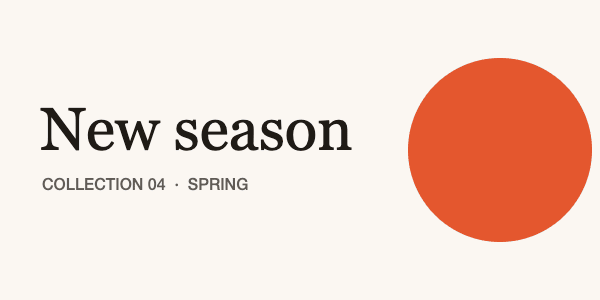

# GL Transitions

An open collection of 186 transitions from one picture to the next. Each one is a small GPU program that follows one short specification: as `progress` runs from 0 to 1, the outgoing image becomes the incoming one. The collection covers torn paper, ink blooming through water, page curls, accordion folds, cubes, whip pans with motion blur, glitches, iris and clock wipes, film burns and dozens more. Every transition comes with a one-line description, tags and a range for each parameter, so you can choose one by what it looks like. The package is the sources, not a player: you draw them with a few lines of WebGL (below) or through one of the ready-made integrations. Each frame depends only on `progress`, so a transition renders identically every time, which makes it right for frame-exact video.



| | |
|---|---|
| **By** | Gaëtan Renaudeau (gre) and contributors; each transition credits its own author |
| **Demo** | [gl-transitions.com](https://gl-transitions.com) (a gallery and a live editor) |
| **Source** | [gl-transitions/gl-transitions](https://github.com/gl-transitions/gl-transitions) (the npm package is `packages/gl-transitions`) |
| **Licence** | MIT (keep notice): no visible credit; the licence stays inside `node_modules`. Read on 2026-11-06 at v3.0.0. Each transition also states its licence in its header: 184 are MIT, `InvertedPageCurl` is BSD-3-Clause and `StereoViewer` is BSD-2-Clause, which are keep-notice terms too |
| **Needs** | WebGL (every current browser) and about 40 lines of host code. The package also carries SkSL, GLSL ES 3.00, WGSL and Metal translations for other platforms |

## Install

```bash
npm install gl-transitions      # or: pnpm add gl-transitions
```

The whole collection is one array of about 550 KB (140 KB gzipped). To ship less, copy the one or two `transitions/*.glsl` files you use from the repo; each is self-contained.

## Use it as it comes

Every entry is `{ name, glsl, params, description, tags, textures, author, license }`. Choose by name or by tag:

```js
import transitions from 'gl-transitions';

const inkBleed = transitions.find((t) => t.name === 'InkBleed');
const threeD = transitions.filter((t) => t.tags.includes('3d'));   // also wipe, slide, zoom, glitch, light, …
```

A transition only implements `vec4 transition(vec2 uv)`. The page supplies everything around it: the two images, `progress`, `ratio` and `main()`. That host is the whole player:

```js
function createTransition(gl, t) {
  const frag = `precision highp float;
varying vec2 _uv;
uniform sampler2D from, to;
uniform float progress, ratio;
vec4 getFromColor(vec2 uv) { return texture2D(from, uv); }
vec4 getToColor(vec2 uv) { return texture2D(to, uv); }
${t.glsl}
void main() { gl_FragColor = transition(_uv); }`;
  const vert = 'attribute vec2 _p; varying vec2 _uv; void main() { gl_Position = vec4(_p, 0.0, 1.0); _uv = _p * 0.5 + 0.5; }';
  const shader = (type, src) => {
    const s = gl.createShader(type); gl.shaderSource(s, src); gl.compileShader(s);
    if (!gl.getShaderParameter(s, gl.COMPILE_STATUS)) throw new Error(`${t.name}: ${gl.getShaderInfoLog(s)}`);
    return s;
  };
  const prog = gl.createProgram();
  gl.attachShader(prog, shader(gl.VERTEX_SHADER, vert));
  gl.attachShader(prog, shader(gl.FRAGMENT_SHADER, frag));
  gl.linkProgram(prog);
  const quad = gl.createBuffer();
  gl.bindBuffer(gl.ARRAY_BUFFER, quad);
  gl.bufferData(gl.ARRAY_BUFFER, new Float32Array([-1, -1, 1, -1, -1, 1, -1, 1, 1, -1, 1, 1]), gl.STATIC_DRAW);

  return function draw(fromTexture, toTexture, progress, params = {}) {
    gl.useProgram(prog);
    const loc = gl.getAttribLocation(prog, '_p');
    gl.bindBuffer(gl.ARRAY_BUFFER, quad);
    gl.enableVertexAttribArray(loc);
    gl.vertexAttribPointer(loc, 2, gl.FLOAT, false, 0, 0);
    gl.activeTexture(gl.TEXTURE0); gl.bindTexture(gl.TEXTURE_2D, fromTexture);
    gl.activeTexture(gl.TEXTURE1); gl.bindTexture(gl.TEXTURE_2D, toTexture);
    gl.uniform1i(gl.getUniformLocation(prog, 'from'), 0);
    gl.uniform1i(gl.getUniformLocation(prog, 'to'), 1);
    gl.uniform1f(gl.getUniformLocation(prog, 'progress'), progress);
    gl.uniform1f(gl.getUniformLocation(prog, 'ratio'), gl.drawingBufferWidth / gl.drawingBufferHeight);
    for (const [name, p] of Object.entries(t.params)) {   // every parameter: its default unless you pass one
      const u = gl.getUniformLocation(prog, name);
      if (!u) continue;
      const v = [].concat(params[name] ?? p.default);
      if (p.type === 'float') gl.uniform1f(u, v[0]);
      else if (p.type === 'int' || p.type === 'bool') gl.uniform1i(u, Number(v[0]));
      else if (p.type.startsWith('vec')) gl[`uniform${p.type[3]}fv`](u, v);
      else if (p.type.startsWith('ivec')) gl[`uniform${p.type[4]}iv`](u, v);
    }
    gl.drawArrays(gl.TRIANGLES, 0, 6);
  };
}
```

Upload each picture flipped, because the spec puts `uv` (0, 0) at the bottom left:

```js
const canvas = document.querySelector('canvas');
const gl = canvas.getContext('webgl');
function texture(image) {                       // an  that has loaded, a <canvas> or a <video>
  const t = gl.createTexture();
  gl.bindTexture(gl.TEXTURE_2D, t);
  gl.pixelStorei(gl.UNPACK_FLIP_Y_WEBGL, true);
  gl.texImage2D(gl.TEXTURE_2D, 0, gl.RGBA, gl.RGBA, gl.UNSIGNED_BYTE, image);
  gl.texParameteri(gl.TEXTURE_2D, gl.TEXTURE_MIN_FILTER, gl.LINEAR);
  gl.texParameteri(gl.TEXTURE_2D, gl.TEXTURE_WRAP_S, gl.CLAMP_TO_EDGE);
  gl.texParameteri(gl.TEXTURE_2D, gl.TEXTURE_WRAP_T, gl.CLAMP_TO_EDGE);
  return t;
}

const draw = createTransition(gl, inkBleed);
const a = texture(firstImage), b = texture(secondImage);
draw(a, b, 0.5);                                // halfway
```

**Timed to the millisecond, or to the frame.** `progress` is just a number, so drive it from whatever keeps time. On a page, use `requestAnimationFrame`. For video, compute it from the frame's time: `draw(a, b, ease((t - start) / duration))`. Clamp it to 0–1 first.

**Elsewhere.** The repo's README lists ready-made integrations for React Native Skia, Remotion, FFmpeg (through `ffmpeg-gl-transition` or `xfade-easing`), editly, Swift, Android and Rust. Remotion itself has its own licence, which requires a paid company licence for larger for-profit companies. If you only need simple cuts between finished video clips, FFmpeg's built-in `xfade` filter has nearly 60 wipes, slides and fades and needs none of this.

## Use it in your brand

The transitions have no look of their own: the two pictures carry your brand. Where a transition paints a colour of its own, it takes it as a parameter. Fifty-six parameters across the collection are marked `color: true` in `params`. Examples are `FadeColor`'s `color`, `PaperTear`'s `paper` and `shadow`, `BurnThrough`'s `burnColor` and `CircleIris`'s `backColor`. Pass them by hand as red, green, blue and alpha from 0 to 1. There's no `pa add --brand` adapter, because a handful of optional colours isn't worth one:

```js
const rgba = (hex, alpha = 1) => [1, 3, 5].map((i) => parseInt(hex.slice(i, i + 2), 16) / 255).concat(alpha);

const fadeColor = createTransition(gl, transitions.find((t) => t.name === 'FadeColor'));
fadeColor(a, b, p, { color: rgba('#E4572E') });   // fade through your primary colour
```

## Notes

- **It needs a host.** The package holds transition sources, not a player. The contract between the two is the [GL Transition specification v1](https://github.com/gl-transitions/gl-transitions#gl-transition-specification-v1). The host is `createTransition` above (the preview used the same code).
- **One WebGL context, not one per canvas.** Browsers keep only about 16 live WebGL contexts per page. Past that, the oldest canvases silently go blank. To show many transitions at once, draw them through one context and copy each result out with `drawImage` onto an ordinary canvas.
- **Frame-exact for video.** Each frame depends only on `progress` and the parameters, with no clock and no randomness at run time. In the preview's test page, frame 30 drawn straight after a jump to frame 100 matched the in-order frame pixel for pixel.
- **Extra textures.** Two transitions need an extra picture: `DisplacementMap` needs `displacementMap`, and `LumaWipe` needs `luma`. All the others need only the two images.
- **Version 3 changes.** 3.0 removed twelve near-duplicates of other transitions. The package README has a table of replacements for anyone coming from 2.x.
- **Documentation for AI assistants.** The package ships an `llms.txt` and an agent skill (`skills/gl-transitions/SKILL.md`). They're documentation; read them as that.
- **The preview.** Four product-style cards are drawn on a canvas in the two example brands' colours (warm paper and cool slate). They're rendered at 600 × 300 through the host above with a frame-stepped clock, at 20 frames a second. The transitions are `PaperTear`, `InkBleed`, `InvertedPageCurl` and `WhipPan`, at their default settings.
