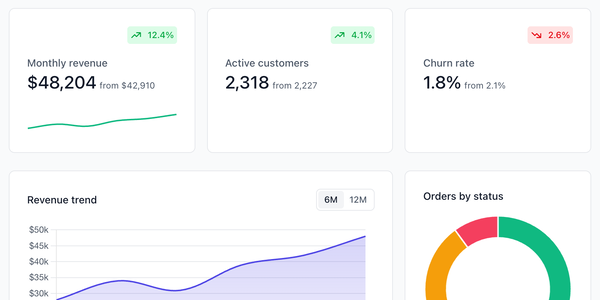

# HyperUI

Copy-and-paste HTML for Tailwind CSS: about 300 components in 68 groups, plus five full-page templates. The marketing set covers headers, heroes, pricing, CTAs, FAQs, stats, product and blog cards, carts and footers. The application set covers stat cards, tables, tabs, toggles, steps, modals, side menus, toasts and charts, and there's a separate neobrutalism set. The templates are an analytics dashboard, a storefront, a SaaS landing page, a support inbox and a portfolio. There's no package and no JavaScript framework: you copy the markup from the site, paste it into a page, and it's yours. Most components come with a dark twin.



| | |
|---|---|
| **By** | Mark Mead |
| **Demo** | [hyperui.dev](https://www.hyperui.dev) |
| **Source** | [markmead/hyperui › public/examples](https://github.com/markmead/hyperui/tree/main/public/examples) |
| **Licence** | MIT (keep notice): no visible credit, but copied markup should keep the MIT notice as a comment in your source (see Install). Covers the component and template markup. Not covered: the photos in the examples (hot-linked from Unsplash under Unsplash's own licence) and Chart.js (MIT, a separate project), which the chart components and dashboard templates load from a CDN. There's no paid tier. Read on 2026-11-12 at commit `b3941ba` ([LICENSE](https://github.com/markmead/hyperui/blob/b3941ba0e361bd827c27f462eaecbb04879bd20e/LICENSE)) |
| **Needs** | Tailwind CSS v4. Form components need the `@tailwindcss/forms` plugin, and charts need Chart.js |

## Install

There's nothing to install. Find a component on [hyperui.dev](https://www.hyperui.dev), click **Copy**, then **Copy HTML**, and paste it into a file your Tailwind build scans. The site's preview toolbar shows each one at phone to desktop widths, and offers the dark version where there is one.

For the form components (contact forms, newsletter sign-ups, inputs, selects, checkboxes, carts):

```bash
npm install -D @tailwindcss/forms        # or: pnpm add -D @tailwindcss/forms
```

```css
@import "tailwindcss";
@plugin "@tailwindcss/forms";
```

**Keep the MIT notice.** Put it in your source next to the pasted markup. A template comment that never reaches the browser (in JSX, Blade, Twig, Liquid…) works, and so does a plain HTML comment. Then save the licence once in your repo:

```html
<!-- Based on HyperUI by Mark Mead (https://www.hyperui.dev). MIT licence; full text in /licences/hyperui.txt -->
```

```bash
mkdir -p licences && curl -sL https://raw.githubusercontent.com/markmead/hyperui/main/LICENSE -o licences/hyperui.txt
```

## Use it as it comes

The markup is plain Tailwind classes, so pasted components look like the site straight away. The preview is the top of the [analytics dashboard](https://www.hyperui.dev/components/templates/analytics-dashboard) template, unedited, rendered with Tailwind 4.3 in the system sans.

- **Dark twins** use Tailwind's `dark:` variant. Out of the box that follows the visitor's system setting. To switch on a class instead, as the site does, add `@custom-variant dark (&:where(.dark, .dark *));` to your CSS and put `class="dark"` on `<html>`.
- **The templates are starting points.** HyperUI says so itself: each one is a single static page with placeholder copy, people and photos, not a finished app. The charts are drawn by inline Chart.js scripts.
- **Interactive bits stay simple.** Accordions use `<details>`, toggles use a hidden checkbox, and modals use the native `<dialog>` element. Dropdowns and toasts are static markup, so you open and close them with your own code.

## Use it in your brand

There's no brand adapter, because HyperUI has no theme to plug into: each component uses Tailwind's stock palette classes, grey for text and surfaces plus one accent (usually `indigo-600`, sometimes blue, teal or purple). A brand adapter would have to invent eleven-step colour ramps from your one primary, which this repo doesn't do.

Fonts and corners already follow you. Components carry no font classes, so they use your page's font. Their `rounded-sm`/`-md`/`-lg` corners follow your Tailwind radius scale, which in a shadcn/ui project is tied to `--radius`.

For colours, the pasted markup is yours to edit. In a project with shadcn-style colour tokens (`pa add shadcn-ui --brand brand.json` writes them), swap the palette classes for token classes once per component:

| HyperUI uses | Swap for |
|---|---|
| `bg-indigo-600`, `hover:bg-indigo-700`, `text-indigo-600`, `border-indigo-600`, `ring-indigo-600` (or the blue/teal/purple equivalents) | `bg-primary`, `hover:bg-primary/90`, `text-primary`, `border-primary`, `ring-primary` |
| `text-white` on an accent button | `text-primary-foreground` |
| `bg-white` | `bg-background`, or `bg-card` for cards |
| `text-gray-900` | `text-foreground` |
| `text-gray-500`, `-600`, `-700` | `text-muted-foreground` |
| `bg-gray-50`, `bg-gray-100` | `bg-muted` |
| `border-gray-100`, `-200`, `divide-gray-200` | `border-border`, `divide-border` |
| the dark twin's `dark:` classes | delete them, because the tokens already switch in `.dark` |

Leave the green, amber and red status badges alone: they mean success, warning and error, not brand. In the chart templates, the colours are hex values in the Chart.js script (`#4f46e5` and `rgba(79, 70, 229, …)` are the indigo line and fill). Replace them with your primary.

## Notes

- **Bring your own photos.** The examples hot-link stock photos from `images.unsplash.com`. They're placeholders, not part of HyperUI, so swap in your own.
- The names, emails and the "Orbitly" product in the templates are placeholders. Replace them.
- HyperUI is built for Tailwind v4. Pasting into a Tailwind v3 project mostly works, but v4 renamed some sizes (`shadow-xs`, `rounded-sm`), so expect small differences.
- Updates land often (the last push was 2026-11-12). Because pasted code is yours, they never change your site. Re-copy a component when you want a fix.
