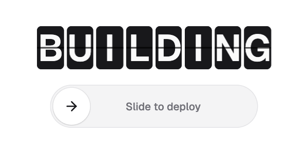

# Kokonut UI

A hundred and sixteen components by Dorian Baffier that each do one thing with real character: a departure board whose letters flip round a drum to the next word, a slide-to-confirm track that wipes its label white as you drag, a hold-to-delete button, a boarding pass, a receipt that prints, a seat map, a wheel picker, and a large set for AI chat screens (tool approval, citations, a model picker, a diff review). Motion is tuned per component and respects reduced-motion settings in 107 of them. Like shadcn/ui it's copy-and-paste through the shadcn CLI, built on the free `motion` package.



| | |
|---|---|
| **By** | Dorian Baffier (Kokonut Labs) |
| **Demo** | [kokonutui.com/docs](https://kokonutui.com/docs) |
| **Source** | [kokonut-labs/kokonutui › components/kokonutui](https://github.com/kokonut-labs/kokonutui/tree/main/components/kokonutui) |
| **Licence** | MIT (keep notice): no visible credit, but copied files must keep the MIT notice as a comment (see Install). Free components only: **Kokonut UI Pro** ([kokonutui.pro](https://kokonutui.pro)) is a separate paid product, with its own components, blocks and the templates, and isn't covered. Read on 2026-11-12 at commit `8af6e27` |
| **Needs** | React 19, Tailwind CSS v4, the `motion` package, `lucide-react`, and a `cn()` helper in `@/lib/utils`. Six components (`clip-trimmer`, `focal-point-picker`, `lightbox-grid`, `morphic-navbar`, `photo-straighten`, `slide-text-button`) also need Next.js |

## Install

The `@kokonutui` namespace is built into the shadcn CLI. Each component lands in `components/kokonutui/` and installs its packages:

```bash
npx shadcn@latest add @kokonutui/split-flap-text      # or: pnpm dlx shadcn@latest add @kokonutui/split-flap-text
npx shadcn@latest add @kokonutui/slide-to-confirm
npx shadcn@latest add kokonut-labs/kokonutui/slide-to-confirm   # the same file, straight from the GitHub repo
```

Outside a shadcn project you need Tailwind and a `cn()` helper first:

```bash
npm install motion lucide-react clsx tailwind-merge     # or: pnpm add motion lucide-react clsx tailwind-merge
```

```ts
// lib/utils.ts
import { clsx, type ClassValue } from 'clsx';
import { twMerge } from 'tailwind-merge';
export function cn(...inputs: ClassValue[]) { return twMerge(clsx(inputs)); }
```

**Keep the MIT notice.** The CLI doesn't add one, so put this at the top of each copied file, and save the licence once next to them:

```tsx
// Based on Kokonut UI (https://kokonutui.com)
// Copyright (c) 2025 kokonutUI. MIT licence; full text in ./LICENSE
```

```bash
curl -sL https://raw.githubusercontent.com/kokonut-labs/kokonutui/main/LICENSE -o components/kokonutui/LICENSE
```

## Use it as it comes

```tsx
import SplitFlapText from '@/components/kokonutui/split-flap-text';
import SlideToConfirm from '@/components/kokonutui/slide-to-confirm';

<SplitFlapText words={['BUILDING', 'TESTING', 'LIVE NOW']} interval={3400} />
<SplitFlapText text="GATE 12" />                     // one fixed word, flips when it changes

<SlideToConfirm label="Slide to deploy" confirmingLabel="Deploying" doneLabel="Deployed"
  onConfirm={() => deploy()} />                       // return a promise; it shows "Deploying" until it settles
```

The preview is these two components unedited, the board at `text-[36px]`, rendered frame by frame at 20 fps. The interval is 3.4 s (the default is 3.8 s) to keep the loop short. Leave at least 2.7 s: a tile only flips forward, so O to N goes 43 flaps round the drum.

**The best free components** (116 in all; the [docs](https://kokonutui.com/docs) show each live):

| Group | Components | Good for |
|---|---|---|
| Text | `split-flap-text`, `spoiler-text`, `marker-text`, `type-writer` | headlines and status lines with a physical feel |
| Buttons | `slide-to-confirm`, `hold-button`, `tear-button`, `undo-button`, `save-button` | actions that need a deliberate gesture: pay, delete, publish |
| Cards | `boarding-pass`, `currency-transfer`, `receipt-printer`, `uptime-card`, `metric-card`, `spending-ring` | confirmations, status pages, dashboards |
| Inputs | `seat-map`, `wheel-picker`, `amount-pad`, `signature-pad`, `timezone-planner`, `slot-picker` | booking, payments and scheduling flows |
| Feedback | `promise-toast`, `save-status`, `inline-alert`, `empty-state`, `helpful-rating` | telling people what just happened |
| AI | `ai-tool-approval`, `ai-citations`, `ai-model-selector`, `ai-diff-review`, `ai-voice` | chat and agent screens |
| Backgrounds | `caustics-background`, `halftone-background`, `topo-background`, `rain-glass-background` | a moving surface behind a hero |

## Use it in your brand

There's no adapter, because Kokonut doesn't read your theme. Nearly every component (107 of 116) is drawn in Tailwind's zinc greys with white and black, plus emerald, amber and red for status, and each has its own `dark:` colours. Rendered under the shared shadcn theme from this repo, the board and the slider stayed exactly as they ship. So `pa add kokonut-ui` installs nothing and prints a pointer here. Three ways to bring your colours in, from lightest to heaviest:

1. **Props, where they exist.** `split-flap-text` takes `tileClassName` (`tileClassName="bg-primary text-primary-foreground"` gives brand-coloured tiles); `hold-button` has a `variant` (`red`, `green`, `blue`, `orange`, `grey`); most take `className`.
2. **Edit the copied file.** It's your code. Swap the classes for your theme tokens once:

   | Kokonut uses | Swap for |
   |---|---|
   | `bg-white`, `dark:bg-zinc-900` / `dark:bg-zinc-950` | `bg-background` (or `bg-card`) |
   | `text-zinc-900`, `dark:text-zinc-100` | `text-foreground` |
   | `text-zinc-400` / `text-zinc-500` | `text-muted-foreground` |
   | `border-zinc-200`, `dark:border-zinc-800` | `border-border` |
   | `bg-zinc-900` / `bg-black` on buttons and fills | `bg-primary text-primary-foreground` |

   Delete the `dark:` twin of each class you swap, because your variables already change in `.dark`.
3. **Retint all of Kokonut at once.** Redefine Tailwind's zinc scale in your CSS, for example `@theme { --color-zinc-900: #0F172A; --color-zinc-50: #F6F8FB; }`. Every zinc class follows, Kokonut's and anyone else's, so do it only if nothing else in the project relies on zinc.

Tested on 2026-11-12: `tileClassName` and the zinc override both recoloured the board; the shadcn theme alone changed nothing.

## Notes

- **Avoid Pro and the demo copy.** Some docs pages are previews of Pro components (they say "Part of Kokonut UI Pro", such as Pay Button and Onboarding Checklist) and the templates are Pro; they aren't in the free registry. Several free components ship demo text naming real banks and people (`currency-transfer` names Deutsche Bank and Chase); pass your own props before shipping.
- Animation runs on Motion springs, timers and Web Animations. To capture exact frames for a video, stub `setTimeout`, `setInterval`, `requestAnimationFrame`, `performance.now` and `Date.now` with one clock, and pause every `element.animate()` so you can set its `currentTime` per frame.
- Components with hooks start with `'use client'` (113 of 116), so they work in Next.js App Router pages. Because you own the copied files, an upstream change never breaks your site.
