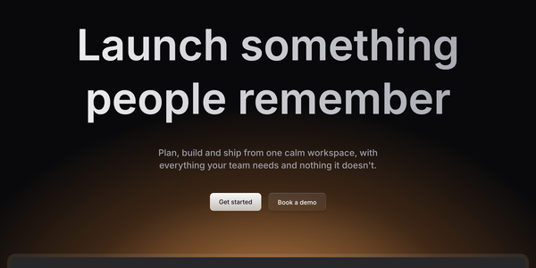

# Launch UI

Landing-page sections by Mikolaj Dobrucki, built on shadcn/ui for Next.js: a navbar, a hero with a gradient headline, a soft radial glow and a framed product screenshot, then logos, feature items, stats, pricing, questions, a call to action and a footer. The type scale, spacing and the glow carry a page on their own, and dark mode is designed, not inverted. Sections install one at a time through the shadcn CLI and become your code.



| | |
|---|---|
| **By** | Mikolaj Dobrucki |
| **Demo** | [launchuicomponents.com](https://www.launchuicomponents.com) · [live preview](https://www.launchuicomponents.com/preview) |
| **Source** | [launch-ui/launch-ui](https://github.com/launch-ui/launch-ui) |
| **Licence** | MIT (keep notice) for the repo and the free sections: no visible credit, but copied files must keep the MIT notice as a comment (see Install). The **Pro** version ([launchuicomponents.com/pricing](https://www.launchuicomponents.com/pricing): bento grid, feature, tabs, social proof, testimonials, carousel, gallery, and the templates) is a separate paid product and isn't covered. Nor are the third-party logos in the logos section (Figma, React, Tailwind, shadcn/ui, TypeScript, GitHub). Read on 2026-11-12 at commit `9387bec` |
| **Needs** | Next.js (the sections import `next/image` and `next/link`), React 19, Tailwind CSS v4 (a [`tailwind-3` branch](https://github.com/launch-ui/launch-ui/tree/tailwind-3) is kept for v3), `next-themes` |

## Install

Start from a shadcn project on Next.js. If you don't have one, this is Launch UI's own command:

```bash
npx shadcn@latest init --base radix --template next --no-monorepo --preset nova --name my-app
```

Add the base styles once, then the sections you want. The `@launchui` namespace is built into the shadcn CLI:

```bash
npx shadcn@latest add @launchui/launchui        # theme, glass and fade utilities, placeholders
npx shadcn@latest add @launchui/hero @launchui/stats @launchui/pricing @launchui/cta
```

`@launchui/launchui` replaces your `globals.css` and `@launchui/button` replaces `button.tsx`; the CLI asks first. In an app you've already styled, merge them by hand instead. The free sections are `navbar`, `hero`, `items`, `logos`, `faq`, `stats`, `pricing`, `cta` and `footer`. The Pro names (`bento-grid`, `feature`, `tabs`, `social-proof`, `testimonials`, `carousel`, `gallery`) resolve, but write no files.

Or clone the whole template, a Next.js 16 site with every free section on one page:

```bash
git clone https://github.com/launch-ui/launch-ui.git my-site && cd my-site && npm install   # or: pnpm install
```

**Keep the MIT notice.** The CLI doesn't add one, so put this at the top of each copied file, and save the licence once next to them:

```tsx
// Based on Launch UI by Mikolaj Dobrucki (https://www.launchuicomponents.com)
// Copyright (c) 2024 Mikolaj Dobrucki. MIT licence; full text in ./LICENSE.md
```

```bash
curl -sL https://raw.githubusercontent.com/launch-ui/launch-ui/main/LICENSE.md -o components/sections/LICENSE.md
```

## Use it as it comes

```tsx
import Hero from '@/components/sections/hero/default';
import Screenshot from '@/components/ui/screenshot';

<Hero
  title="Launch something people remember"
  description="Plan, build and ship from one calm workspace, with everything your team needs and nothing it doesn't."
  buttons={[
    { href: '/start', text: 'Get started', variant: 'default' },
    { href: '/demo', text: 'Book a demo', variant: 'glow' },
  ]}
  mockup={<Screenshot srcLight="/app-light.png" srcDark="/app-dark.png" alt="The app" width={1248} height={765} />}
/>
```

The preview is the free `hero` with these props, in dark mode at 1200 px wide, cropped from the headline to the top of the screenshot frame. Every other line is stock: the gradient headline, the staggered fade-up as it loads, and the two-layer `Glow` behind the `MockupFrame`.

**The free sections:**

| Section | What it does | Good for |
|---|---|---|
| `hero` | headline, line, buttons, then a framed screenshot with the glow behind it | the top of a product page |
| `navbar` | logo, links with dropdowns, buttons, a mobile sheet | every page |
| `logos` | a row of customer or tool logos with a badge | "used by" proof |
| `items` | a grid of icon, title and line | features |
| `stats` | big figures with labels, in the brand colour | adoption numbers |
| `pricing` | plan columns with a highlighted one | pricing pages |
| `faq` | an accordion of questions | objections and details |
| `cta` | a closing headline and button over a glow | the end of the page |
| `footer` | link columns, copyright and a light/dark switch | every page |

## Use it in your brand

Launch UI uses shadcn's variable names, so it takes the shared shadcn theme:

```bash
cd your-project
pa add launch-ui --brand brand.json
```

This writes `components/brand-theme.css`, the `:root` and `.dark` blocks in your colours, fonts and corner radius. Paste them over the ones in `globals.css`, or import the file after it. Then two things the theme can't do on its own:

**The glow is Launch UI's own colour.** The glow, badges, the pricing highlight and the stats figures read `--brand` and `--brand-foreground` (orange out of the box), which shadcn doesn't have. Point them at your primary:

```css
:root, .dark {
  --brand: var(--primary);
  --brand-foreground: var(--primary);
}
```

**The font is set on `<body>`.** Launch UI's layout loads Inter with `next/font` and puts its `--font-sans` on `<body>`, which hides the theme's `--font-sans` on `:root`. Remove `${inter.variable}` from the body's class (and load your own font your usual way), or load your font with `next/font` under `variable: "--font-sans"`.

Tested on 2026-11-12 with both example brands from this repo: buttons, text, surfaces, the dark scheme and the radius followed straight away; the glow stayed orange until the two lines above, and the font followed once the body variable was gone.

## Notes

- **Replace the defaults.** Every section's default props link to launchuicomponents.com and some name Launch UI ("New version of Launch UI is out!", a GitHub button). Pass your own text and links. The hero's grey placeholder screenshot comes from the registry; swap in your own.
- It's built for Next.js. In a Vite project the base item still writes to `src/app/globals.css` and `src/public/`, and `next/image` and `next/link` won't resolve.
- The registry files match the GitHub repo at `9387bec`, with the site's config values written in.
- The entrance animation (`animate-appear`: fade up from a blur, staggered) is plain CSS.
