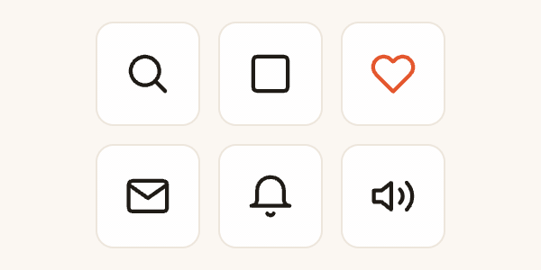

# Lottie (lottie-web)

Lottie is the format motion designers use to ship After Effects animations to apps and websites. The Bodymovin plugin exports a composition as data, and lottie-web plays it back as SVG, canvas or HTML. Because it's vector data, the result is crisp at any size, usually far smaller than the same thing as a video, and can be recoloured. Animated icons, illustrated empty states, onboarding scenes, loading spinners and success ticks are the everyday uses. It's by Hernan Torrisi, who wrote Bodymovin, with Airbnb, and it has 10 million npm downloads a week. Any frame can be shown directly, so an animation can also be stepped frame by frame for video.



| | |
|---|---|
| **By** | Hernan Torrisi (author of the Bodymovin exporter), with Airbnb |
| **Demo** | [airbnb.io/lottie](https://airbnb.io/lottie/) and the [CodePen collection](https://codepen.io/collection/nVYWZR/) |
| **Source** | [airbnb/lottie-web](https://github.com/airbnb/lottie-web) |
| **Licence** | MIT (keep notice): no visible credit; the licence stays inside `node_modules`. Read on 2026-11-06 at v5.13.0 from `LICENSE.md` ("Copyright (c) 2015 Bodymovin"); the README has no licence section. Animation files carry their own licences (see Notes) |
| **Needs** | Any modern browser. No framework, no dependencies |

## Install

```bash
npm install lottie-web      # or: pnpm add lottie-web
```

## Use it as it comes

```js
// The light build: SVG only, no After Effects expressions, so nothing in a file can run code (see Notes)
import lottie from 'lottie-web/build/player/lottie_light';

const anim = lottie.loadAnimation({
  container: document.getElementById('hero'),
  renderer: 'svg',
  loop: true,
  autoplay: true,
  path: '/animations/hero.json',   // or animationData: an object you already have
});

anim.setSpeed(1.5);
anim.playSegments([0, 30], true);  // play only part of it
anim.goToAndStop(45, true);        // freeze on frame 45 (false would mean milliseconds)
anim.addEventListener('complete', () => console.log('done'));
anim.destroy();                    // when the element goes away
```

Choose the build by what your files need:

| Import | Draws with | After Effects expressions | Minified |
|---|---|---|---|
| `lottie-web` (the full player) | SVG, canvas or HTML | yes, through `eval` | 306 KB |
| `lottie-web/build/player/lottie_light` | SVG | no | 168 KB |
| `lottie-web/build/player/lottie_light_canvas` | canvas | no | 203 KB |
| `lottie-web/build/player/lottie_svg` · `lottie_canvas` | SVG · canvas | yes, through `eval` | 243 KB · 266 KB |

**Frame by frame, for video.** Turn autoplay off and show the frame for each moment. The player then never looks at the clock:

```js
const data = await (await fetch('/animations/hero.json')).json();
const anim = lottie.loadAnimation({ container, renderer: 'svg', autoplay: false, loop: false, animationData: data });
const frames = data.op - data.ip;                 // its length in frames, at data.fr frames a second

function render(t) {                              // t: seconds since the animation started
  anim.goToAndStop(Math.min(frames - 1, t * data.fr), true);
}
```

Fractional frames are drawn in between ("subframes", on by default). Use `anim.setSubframe(false)` to snap to whole frames, as After Effects shows them.

**Reduced motion.** When `prefers-reduced-motion` is set, skip `play()` and show a finished frame with `goToAndStop(frames - 1, true)`.

## Use it in your brand

Colours live inside each animation file, and lottie-web has no theming option, so there's no `pa add --brand` adapter. Recolour by hand by rewriting the colour of every stroke and fill in the data before loading it. This works with every renderer:

```js
const rgb = (hex) => [1, 3, 5].map((i) => parseInt(hex.slice(i, i + 2), 16) / 255);
function recolour(node, hex) {           // 'st' = stroke, 'fl' = fill; a.0 = a colour that doesn't animate
  if (Array.isArray(node)) node.forEach((n) => recolour(n, hex));
  else if (node && typeof node === 'object') {
    if ((node.ty === 'st' || node.ty === 'fl') && node.c?.a === 0) node.c.k = [...rgb(hex), 1];
    Object.values(node).forEach((v) => recolour(v, hex));
  }
}

recolour(data, '#1F1B16');               // your foreground colour
lottie.loadAnimation({ container, renderer: 'svg', animationData: data });
```

That paints the whole animation in one colour, which suits line icons. For illustrations with several colours, map each original colour to a brand colour instead of overwriting them all.

## Notes

- **A Lottie file from the web is code, not just data.** The full player, `lottie_svg` and `lottie_canvas` run a file's After Effects expressions through JavaScript's `eval`. Use a `light` build unless a file needs expressions. A file that uses them stores them as text in its properties (`"x": "…"`). It plays in a light build without errors, but it can move wrongly. In a test, the repo's `lights` demo (a string of bulbs swinging) played in `lottie_light` with every bulb bunched in one spot. Check each such file, and use the full build only for files you trust. Four of the eight demo files in the lottie-web repo use expressions.
- **Frame-exact for video.** `goToAndStop(frame, true)` with autoplay off draws the same picture for the same frame every time. In the preview's test page, the real clock was frozen. Frame 30 drawn straight after a jump to frame 70 matched the in-order frame pixel for pixel. Build the page in a fixed order before anything loads: the first version of the preview placed its tiles in whatever order the files arrived.
- **The faster player renders some files differently.** LottieFiles' `@lottiefiles/dotlottie-web` (MIT) draws with ThorVG compiled to WebAssembly and adds `.lottie` files and theming. In a side-by-side test of eight files, it ignored the movement on one file that used expressions, and drew another with the wrong colours. It also fetches its 1.2 MB WebAssembly file from a public CDN unless you call `DotLottie.setWasmUrl()`. If you switch to it, check every file; lottie-web is the reference.
- **Where animations come from, and their licences.** [useAnimations](https://github.com/useAnimations/react-useanimations) has 300 line icons, MIT-licensed, and its README says "free for personal and commercial use. Attribution is not required". It also includes brand logos (GitHub, Discord and others), and the MIT licence doesn't cover those trademarks. LottieFiles' free animations use the "Lottie Simple License". It allows commercial use with no credit, but says every "display, publication, performance, or distribution of Files must contain (and be subject to) the same terms". It also excludes "the right to collect or compile Files from LottieFiles to replicate or develop a similar or competing service". Read it before building a library out of their files.
- **Last push September 2025.** It's mature rather than busy, with 10 million npm downloads a week; check the changelog when a new version lands.
- **The preview.** Six useAnimations icons (search to cross, checkbox, heart, mail, notification, volume) were recoloured with `recolour` above to the warm example brand's foreground, with the heart in its primary. They were played with `lottie_light` and `goToAndStop` at 25 frames a second, with a frame-stepped clock.
