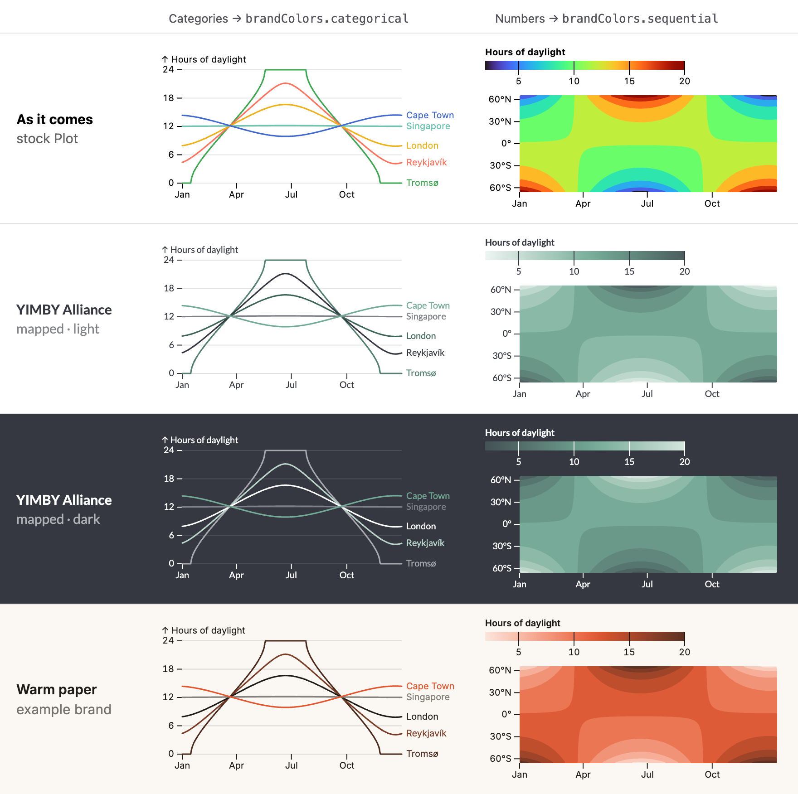

# Observable Plot

Charts in a few lines of JavaScript, made by the team behind D3. You describe a chart as marks (lines, dots, bars, text, contours) laid over scales, and Plot handles the axes, ticks, legends and tooltips. Its defaults are quiet and editorial: thin axes, no chart junk, room for direct labels. It renders plain SVG, so a chart looks the same in every browser and prints cleanly.



| | |
|---|---|
| **By** | Observable (Mike Bostock, Philippe Rivière and team) |
| **Docs** | [observablehq.com/plot](https://observablehq.com/plot/) |
| **Source** | [observablehq/plot](https://github.com/observablehq/plot) |
| **Licence** | ISC (keep notice): no visible credit; the licence stays inside `node_modules`. Read on 2026-10-15 at v0.6.17. Copy examples from the docs site, not from the Observable gallery notebooks: 200 of the 217 gallery notebooks carry no licence, so their code isn't yours to reuse |
| **Needs** | Any JavaScript project: plain HTML, React, Svelte, Vue. No framework required |

## Install

```bash
npm install @observablehq/plot      # or: pnpm add @observablehq/plot
```

## Use it as it comes

```js
import * as Plot from '@observablehq/plot';

const chart = Plot.plot({
  y: { grid: true, label: 'Hours of daylight' },
  marks: [
    Plot.lineY(days, { x: 'date', y: 'hours', stroke: 'place' }),
    Plot.text(days, Plot.selectLast({ x: 'date', y: 'hours', z: 'place', text: 'place', fill: 'place', dx: 5, textAnchor: 'start' })),
  ],
});
document.querySelector('#chart').append(chart);
```

`Plot.plot` returns an SVG element (or a `<figure>` when you add a `title`, `caption` or legend), so you append it wherever the chart goes. In React, build it in a `useEffect` and append it to a ref:

```tsx
useEffect(() => {
  const chart = Plot.plot({ marks: [Plot.dot(data, { x: 'a', y: 'b', tip: true })] });
  ref.current!.append(chart);
  return () => chart.remove();
}, [data]);
```

**Static figures.** For a briefing or a studio figure, run Plot in Node with jsdom (`npm install jsdom`): `Plot.plot({ document: new JSDOM('').window.document, ...options }).outerHTML` is a finished SVG file. `brandPlot` works the same way.

**The good parts.** `tip: true` on any mark gives hover tooltips. `Plot.text` with `Plot.selectLast` puts labels at line ends instead of a legend. `Plot.contour`, `Plot.raster`, `Plot.hexbin` and `Plot.density` do heatmaps and density. `fx` and `fy` facet a chart into small multiples. Transforms (`Plot.binX`, `Plot.groupY`, `Plot.stackY`, `Plot.windowY`) do the counting and smoothing for you.

**Type and colour as shipped.** Text is 10 px `system-ui` in `currentColor`, so it follows the page's text colour. Categories use the `observable10` scheme and numbers use `turbo` (the rainbow in the top row of the sheet). Grid lines are the text colour at 10%.

## Use it in your brand

The brand version wraps `Plot.plot`, so it takes exactly the same options. It sets your sans font and text colour, swaps the default grid for your border colour, fills tooltips with your background, and gives colour scales your palettes. Anything you pass wins.

```bash
cd your-project
node ~/projects/product-aesthetics/bin/pa.mjs add observable-plot --brand brand.json
# or read the colours straight from your shadcn / Tailwind CSS:
node ~/projects/product-aesthetics/bin/pa.mjs add observable-plot --brand src/app/globals.css
```

This installs `@observablehq/plot` and writes `components/brand-plot.js` plus `brand-plot.d.ts`, with your colours and font baked in:

```js
import * as Plot from '@observablehq/plot';
import { brandPlot, brandColors } from '@/components/brand-plot';

brandPlot({ grid: true, marks: [Plot.lineY(days, { x: 'date', y: 'hours', stroke: 'place' })] });
brandPlot(options, { theme: 'dark' });                                  // your dark scheme
Plot.barY(data, { x: 'k', y: 'v', fill: brandColors.primary });        // one series in your primary
```

| What | Light | Dark (`theme: 'dark'`) |
|---|---|---|
| Type | your sans font in your text colour, on a transparent background | your dark text colour |
| Categories | `brandColors.categorical` | `brandColors.dark.categorical` |
| Numbers | `brandColors.sequential`: a pale tint of primary, through primary, to a deep shade | `brandColors.dark.sequential`: near the background, through primary, to a pale tint |
| Ordered categories (`color: { type: 'ordinal' }`) | evenly spaced steps along the sequential ramp | the same, on the dark ramp |
| Grid | your border colour | your dark border colour |
| Tooltips | filled with your background | filled with your dark background |

**The categorical palette.** It starts with your primary, accent and text colour exactly as given. Then it adds OKLab mixes of those colours (and your background), picking whichever is most different from what's already in the palette, until nothing distinct is left or it reaches eight. Every mixed colour reaches 3:1 against the background. A one-hue brand gives a short palette: YIMBY Alliance gets six (sage, dark green, charcoal, grey, mid green, deep teal) and the example brand gets eight.

**When it leaves things alone.** If you set `color.range`, `color.scheme` or `color.interpolate`, it doesn't touch your colours. Diverging and identity scales keep Plot's own. A grid colour you set yourself (`grid: 'red'`) stays as you set it.

Run the command again with `--force` after a brand change.

## Notes

- **It can draw twice.** Plot only knows whether a colour scale holds categories or numbers once it has seen the data. So when a chart has a colour scale and you haven't picked its colours, `brandPlot` draws once, reads the scale type, then draws again with the right palette. Normal charts don't notice. To skip the second pass on a huge chart, pass `color: { range: brandColors.categorical }` or `color: { interpolate: brandRamp(brandColors.sequential) }` yourself.
- **Internals it relies on.** The grid swap looks for Plot's grid groups by their `aria-label` (`x-grid`, `y-grid`, `fx-grid`, `fy-grid`), and only changes those still carrying Plot's default `stroke="currentColor"` and `stroke-opacity="0.1"`. Tooltip fill uses Plot's `--plot-background` CSS variable. If an upgrade changes either, `pa check --online` will flag the new version so the adapter can be re-checked.
- **One-hue brands.** Past the fourth colour, neighbours in a one-hue palette sit close together (the example brand's two browns, YIMBY Alliance's two dark greens). Label lines directly with `Plot.text` and `Plot.selectLast`, as in the sheet, rather than relying on a legend. The palette isn't built for colour-blind safety.
- **YIMBY Alliance primary.** The sage `#73AB96` is 2.6:1 on white, under the 3:1 that graphics want. The adapter uses it as given. For thin lines, the dark green accent reads better.
- **TypeScript.** Plot's own type definitions import D3's. If your project type-checks libraries (`skipLibCheck: false`), add `@types/d3` as a dev dependency. Next.js and Vite templates skip library checks, so they don't need it.
- The charts in the preview and sheet plot hours of daylight worked out with the standard sunrise equation, not a real dataset.
