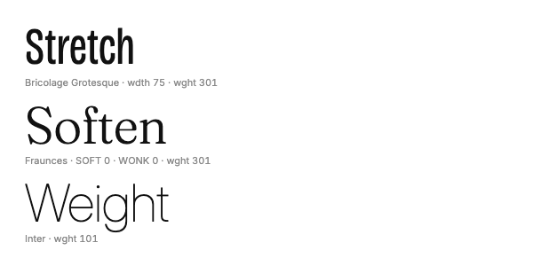

# Open fonts kit

Type does more for a design than anything else on the page, and the best free faces are as good as paid ones. These ten cover nearly every job, from interface text to a shouting video title, and each is among the most-used families on Google Fonts (its popularity rank, out of 1,950 families, is in the table). All are under the SIL Open Font Licence, so they can go anywhere, from websites and apps to video, print and slides, with no credit. [Fontsource](https://fontsource.org) packages every one for npm, so a site self-hosts them rather than calling Google.


| | |
|---|---|
| **By** | The designers named per face below; packaged by Fontsource |
| **Licence** | SIL Open Font Licence 1.1 for every face (keep notice): embed and use anywhere, no credit; don't sell the font files on their own. Fontsource keeps the licence inside each package. Read on 2026-10-15 at Fontsource 5.3.0 |
| **Needs** | Any website or app, or install the TTFs on your computer for Figma, Keynote, video editors and so on |

## The kit

| Face | Job | By | Google Fonts rank | npm package | Variable axes |
|---|---|---|---|---|---|
| **Inter** | Interfaces, body text, data tables: the safe default | Rasmus Andersson | #2 | `@fontsource-variable/inter` | weight 100–900, optical size |
| **Bebas Neue** | Condensed capitals for thumbnails, video titles, posters | Ryoichi Tsunekawa | #9 | `@fontsource/bebas-neue` | one weight, capitals only |
| **JetBrains Mono** | Code, figures, terminal looks | JetBrains (Philipp Nurullin, Konstantin Bulenkov) | #8 | `@fontsource-variable/jetbrains-mono` | weight 100–800 |
| **Space Grotesk** | Tech and data posters, quirky headlines | Florian Karsten | #20 | `@fontsource-variable/space-grotesk` | weight 300–700 |
| **Bricolage Grotesque** | Display with character: ink traps, a little wonky | Mathieu Triay | #23 | `@fontsource-variable/bricolage-grotesque` | weight 200–800, width 75–100, optical size |
| **Geist** | Crisp product and tech look, slides | Vercel (Andrés Briganti and others) | #32 | `@fontsource-variable/geist` | weight 100–900 (and Geist Mono) |
| **IBM Plex** | Long reports: sans, serif and mono that match | Mike Abbink, Bold Monday | #36 | `@fontsource-variable/ibm-plex-sans`, `@fontsource/ibm-plex-serif`, `@fontsource/ibm-plex-mono` | sans: weight, width 75–100 |
| **Instrument Serif** | Editorial headlines, elegant title cards | Rodrigo Fuenzalida, Jordan Egstad | #53 | `@fontsource/instrument-serif` | regular and italic only |
| **Fraunces** | Warm, friendly serif headlines | Undercase Type (Phaedra Charles, Flavia Zimbardi) | #63 | `@fontsource-variable/fraunces` | weight, optical size, softness 0–100, "wonk" 0–1 |
| **Newsreader** | Long-form reading, articles, briefings | Production Type | #89 | `@fontsource-variable/newsreader` | weight 200–800, optical size 6–72 |

Two pairings that work straight away: **Instrument Serif headlines over Inter text** (editorial, calm) and **Bebas Neue titles over Space Grotesk** (loud, social). IBM Plex alone covers a whole report.

## Install

```bash
npm install @fontsource-variable/inter @fontsource/instrument-serif      # or: pnpm add …
```

```js
import '@fontsource-variable/inter';                  // family: 'Inter Variable'
import '@fontsource/instrument-serif/400.css';        // family: 'Instrument Serif'
import '@fontsource/instrument-serif/400-italic.css';
```

Variable packages name the family with "Variable" on the end. For the extra axes, import the package's axis file: `@fontsource-variable/fraunces/full.css` (all four axes), `@fontsource-variable/bricolage-grotesque/standard.css` (weight, width and optical size), `@fontsource-variable/inter/opsz.css`.

For desktop apps, download each family's files from its Google Fonts page and install them.

## Use it as it comes

```css
h1 { font-family: 'Instrument Serif', Georgia, serif; font-weight: 400; }
body { font-family: 'Inter Variable', system-ui, sans-serif; }
.title { font-family: 'Bebas Neue', Impact, sans-serif; letter-spacing: 0.01em; }
```

**In motion.** The variable faces animate smoothly between their extremes, which makes cheap, striking type moves for video and the web:



```js
el.style.fontStretch = `${75 + 25 * t}%`;                          // Bricolage Grotesque: width
el.style.fontWeight = 300 + 600 * t;                               // any variable face: weight
el.style.fontVariationSettings = `'SOFT' ${100 * t}, 'WONK' ${t > 0.5 ? 1 : 0}`;   // Fraunces
```

## Use it in your brand

There's no adapter: a font becomes part of your brand when your style guide names it. `pa` reads your fonts from `--font-sans`, `--font-display` and `--font-mono` (or a brand file's `fonts`), so set one of these there and every adapter in this catalogue picks it up:

```json
"fonts": { "sans": "Inter Variable", "display": "Instrument Serif", "mono": "JetBrains Mono Variable" }
```

## Notes

- Use the name the package registers. `'Inter'` won't match `@fontsource-variable/inter`; it has to be `'Inter Variable'`.
- Popularity has a cost: Inter and Bebas Neue are everywhere, so on their own they read as default. They're at their best paired with something with more character (Instrument Serif, Fraunces, Bricolage Grotesque).
- Bebas Neue has capitals only: lower-case letters come out as the same full-size capitals.
- [Datatype](../datatype) in this catalogue is a font too: it draws inline charts.
