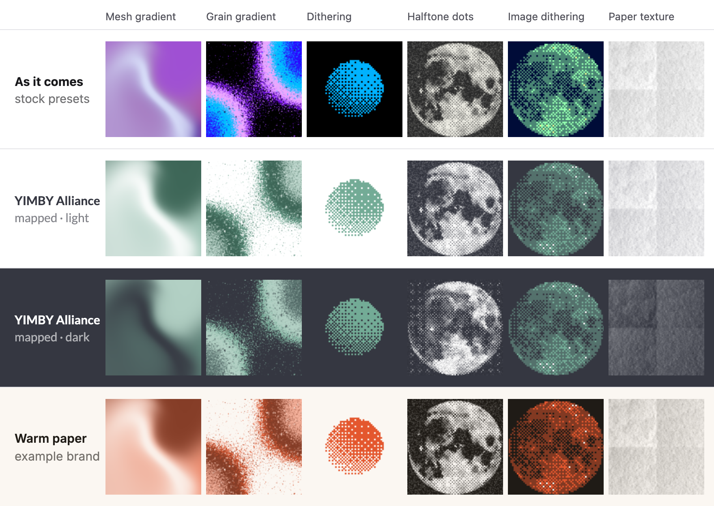

# Paper Shaders

Thirty ready-made WebGL shaders from the team behind the Paper design tool: mesh gradients, grainy gradients, pixel dithering, halftone dots, crumpled paper, liquid metal, god rays and more. Each one is a single component with a handful of props, so you get a moving, art-directed background or a photo treatment without writing GLSL. The core has no dependencies, the shaders render at your screen's real resolution, and they pause when they scroll off screen or the tab is hidden.

> **Licence: use 0.0.77 or later only.** Paper Shaders became Apache-2.0 at v0.0.77. Versions 0.0.47 to 0.0.76 were under the PolyForm Shield licence, which this catalogue doesn't allow. Never install an older version from a tutorial, a CodePen or an old lockfile.



| | |
|---|---|
| **By** | Paper (Lost Coast Labs) |
| **Demo** | [shaders.paper.design](https://shaders.paper.design) |
| **Source** | [paper-design/shaders](https://github.com/paper-design/shaders) |
| **Licence** | Apache-2.0 (keep notice) **from v0.0.77 only**; 0.0.47–0.0.76 were PolyForm Shield. The README says end products need "no visible attribution". Keep the LICENSE and NOTICE files with the code: npm keeps both inside `node_modules`, and if you copy or vendor shader code, copy both files too. Read on 2026-10-15 at v0.0.81 |
| **Needs** | WebGL. React 18 or 19 for the components; the vanilla core (`@paper-design/shaders`) works without a framework |

## Install

```bash
npm install @paper-design/shaders-react@">=0.0.77"      # or: pnpm add @paper-design/shaders-react@">=0.0.77"
npm install @paper-design/shaders@">=0.0.77"            # the vanilla core, without React
```

## Use it as it comes

```tsx
import { MeshGradient, Dithering, HalftoneDots } from '@paper-design/shaders-react';

<MeshGradient style={{ width: '100%', height: 480 }} />                    // the stock purple and pink
<MeshGradient colors={['#e0eaff', '#241d9a', '#f75092']} speed={0.4} distortion={0.8} swirl={0.1} />
<Dithering shape="sphere" type="4x4" colorBack="#000" colorFront="#00b2ff" />
<HalftoneDots image="/photo.jpg" type="gooey" grid="hex" />                // needs an image
```

Every prop has a default from the shader's own Default preset, so `<MeshGradient />` on its own looks like the demo. Each shader also exports its named presets (`meshGradientPresets`, `ditheringPresets`…), which you can spread: `<Dithering {...ditheringPresets[1].params} />`.

| Shaders | |
|---|---|
| Backgrounds | `MeshGradient`, `StaticMeshGradient`, `StaticRadialGradient`, `GrainGradient`, `Warp`, `Swirl`, `Spiral`, `Waves`, `ColorPanels` |
| Noise and patterns | `SimplexNoise`, `PerlinNoise`, `NeuroNoise`, `Voronoi`, `DotGrid`, `DotOrbit`, `Metaballs`, `Dithering` |
| Light and objects | `GodRays`, `SmokeRing`, `PulsingBorder`, `LiquidMetal`, `GemSmoke`, `Heatmap` |
| Photo effects | `HalftoneDots`, `HalftoneCmyk`, `ImageDithering`, `PaperTexture`, `FlutedGlass`, `Water`, `LensDistortion` |

**Motion.** `speed` is a multiplier (0 stops it). `frame` (milliseconds) gives the same picture every time, which is how the preview above was made. The shaders don't check for reduced motion, so pass `speed={0}` when `prefers-reduced-motion` is set.

**Performance.** `maxPixelCount` and `minPixelRatio` trade sharpness for speed on big canvases. Each shader is its own WebGL context, and browsers allow about 16 a page, so keep a page to a few of them.

**Without React.** The core package exports each fragment shader and `ShaderMount`. You pass every uniform yourself, including the sizing ones:

```js
import { ShaderMount, meshGradientFragmentShader, getShaderColorFromString, ShaderFitOptions, defaultObjectSizing as s } from '@paper-design/shaders';

const colors = ['#ffffff', '#c0d9cf', '#73ab96', '#3d6657'];
new ShaderMount(el, meshGradientFragmentShader, {
  u_colors: colors.map(getShaderColorFromString), u_colorsCount: colors.length,
  u_distortion: 0.8, u_swirl: 0.1, u_grainMixer: 0, u_grainOverlay: 0,
  u_fit: ShaderFitOptions[s.fit], u_scale: s.scale, u_rotation: s.rotation, u_originX: s.originX, u_originY: s.originY,
  u_offsetX: s.offsetX, u_offsetY: s.offsetY, u_worldWidth: s.worldWidth, u_worldHeight: s.worldHeight,
}, undefined, 1);   // the last argument is speed
```

## Use it in your brand

The brand version writes colour presets for the six shaders a brand uses most, for light and dark pages. Each preset holds colour props only. Everything else (motion, grain, shape, sizing) falls back to the shader's own Default, so the look stays as Paper designed it, and you can still override any prop.

```bash
cd your-project
node ~/projects/product-aesthetics/bin/pa.mjs add paper-shaders --brand brand.json
# or read the colours straight from your shadcn / Tailwind CSS:
node ~/projects/product-aesthetics/bin/pa.mjs add paper-shaders --brand src/app/globals.css
```

This installs `@paper-design/shaders-react` and writes `components/brand-shaders.js` plus `brand-shaders.d.ts`:

```tsx
import { MeshGradient, Dithering, HalftoneDots } from '@paper-design/shaders-react';
import { brandShaders } from '@/components/brand-shaders';

<MeshGradient {...brandShaders.meshGradient} style={{ width: '100%', height: 480 }} />
<Dithering {...brandShaders.dark.dithering} speed={0.5} />
<HalftoneDots {...brandShaders.halftoneDots} image="/photo.jpg" />
```

| Preset | Light | Dark (`brandShaders.dark.*`) |
|---|---|---|
| `meshGradient` | background, a tint of primary, primary, accent | the same roles from your dark scheme |
| `grainGradient` | primary, accent and a tint, grained over your background | the same, over your dark background |
| `dithering` | primary pixels on your background | primary on your dark background |
| `halftoneDots` | text-colour dots on your background | light dots on your dark background, with `inverted` on so the photo still reads the right way round |
| `imageDithering` | a photo in three tones: text colour for shadows, primary for mid-tones, background for highlights | dark background, primary, light text colour |
| `paperTexture` | a sheet in your background colour, folds in a soft shade of your text colour | the same from your dark scheme |

Where the accent is the primary itself (as in YIMBY Alliance's dark scheme, or a brand with one colour), the presets use primary mixed toward the text colour instead, so the gradient still has two greens or two oranges. The file is plain data with no imports, so you can use it in a server component and pass the props to a client one. Run the command again with `--force` after a brand change.

## Notes

- **Licence history.** The licence changed at v0.0.77: 0.0.47–0.0.76 are PolyForm Shield (source-available, not open source). On 0.0.x versions a caret range like `^0.0.81` allows only that one version, so `npm install` without a range is also safe; what matters is never going below 0.0.77. `pa check --online` re-reads the licence on npm and GitHub.
- **Attribution.** The upstream README says end products need "no visible attribution". The NOTICE file reads "Powered by Paper Shaders: https://shaders.paper.design"; it has to travel with the code, not appear on screen. The README asks anyone who redistributes the code inside another shader library, plugin or tool to keep LICENSE and NOTICE, and calls visible credit appreciated, not required.
- **Paper texture** is subtle on a white brand: a white sheet with grey folds looks much like the stock one. It earns its keep on a coloured or dark page, or over a photo (`image`).
- **YIMBY Alliance.** The sage primary on white is soft (2.6:1). That's fine for these backgrounds, but don't set text straight on a dithering or grain preset without a solid panel behind it.
- The preview shows the stock Default presets of `MeshGradient`, `Dithering` and `HalftoneDots`. The photo is the Moon from NASA's Galileo mission (PIA00405, NASA/JPL, public domain). The animated panels were rendered frame by frame with `frame`, and the loop is closed with a short crossfade.
