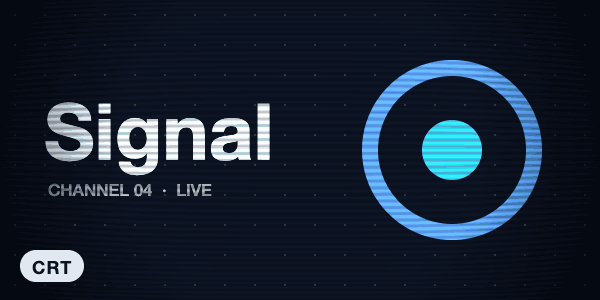

# PixiJS Filters

More than 35 GPU effects for PixiJS, the fast 2D WebGL renderer behind many web games and interactive sites. The looks include:

- old film (grain, scratches, vignette);
- glitch slices with colour split;
- CRT scanlines and curvature;
- shockwave ripples;
- zoom, motion, radial and tilt-shift blur;
- bloom and glow;
- light rays;
- water reflections;
- twist and bulge;
- halftone dots, cross-hatching, ASCII and pixelate.

Each is a filter you put on any PixiJS object: a photo, a video frame or a whole scene. Every animated one is driven by plain numbers (`time`, `seed`, strength), so you can set them from the clock, from scrolling, or frame by frame for video. Version 6 is for PixiJS 8.



| | |
|---|---|
| **By** | The PixiJS team (Mat Groves, Chad Engler and contributors) |
| **Demo** | [pixijs.io/filters/examples](https://pixijs.io/filters/examples/) (every filter, with live controls) |
| **Source** | [pixijs/filters](https://github.com/pixijs/filters) |
| **Licence** | MIT (keep notice): no visible credit; the licence stays inside `node_modules`. Read on 2026-11-06 at v6.1.5. PixiJS itself (`pixi.js`) is MIT too, read the same day at v8.22.0 |
| **Needs** | PixiJS 8 and WebGL (or WebGPU), in any modern browser |

## Install

```bash
npm install pixi.js pixi-filters      # or: pnpm add pixi.js pixi-filters
```

Match the major versions: PixiJS 8 takes pixi-filters 6, and PixiJS 7 takes pixi-filters 5. Each filter can also be imported on its own, for example `pixi-filters/old-film`.

## Use it as it comes

```js
import { Application, Assets, Sprite } from 'pixi.js';
import { OldFilmFilter, ShockwaveFilter } from 'pixi-filters';

const app = new Application();
await app.init({ resizeTo: window, background: '#000' });
document.body.appendChild(app.canvas);

const photo = new Sprite(await Assets.load('/photo.jpg'));
app.stage.addChild(photo);

const film = new OldFilmFilter({ sepia: 0.3, noise: 0.2, scratch: 0.5, vignetting: 0.3 });
const ripple = new ShockwaveFilter({ center: { x: 400, y: 300 }, amplitude: 30, wavelength: 160 });
photo.filters = [film, ripple];

app.ticker.add((ticker) => {
  film.seed = Math.random();               // new grain every frame
  ripple.time += ticker.deltaMS / 1000;    // the ripple spreads
});
```

| Filter | What it does | Animate it with |
|---|---|---|
| `OldFilmFilter` | grain, scratches, sepia, vignette | `seed` |
| `GlitchFilter` | slices shifted sideways, with red and blue split | `seed`, `offset` |
| `CRTFilter` | scanlines, curvature, vignette | `time` |
| `ShockwaveFilter` | a ripple spreading from a point | `time` |
| `GodrayFilter` | rays of light | `time` |
| `ReflectionFilter` | a water reflection with waves | `time` |
| `ZoomBlurFilter` · `MotionBlurFilter` · `RadialBlurFilter` · `TiltShiftFilter` · `KawaseBlurFilter` | blur from a point, along a movement, around a point, a miniature band, all over | `strength`, `velocity`, `angle`, `blur` |
| `AdvancedBloomFilter` · `BloomFilter` · `GlowFilter` | glow from bright areas or round a shape | `bloomScale`, `outerStrength` |
| `PixelateFilter` · `DotFilter` · `CrossHatchFilter` · `AsciiFilter` | mosaic, halftone, pen hatching, text characters | `size`, `scale` |
| `TwistFilter` · `BulgePinchFilter` | warps | `angle`, `strength` |
| `RGBSplitFilter` · `ColorGradientFilter` · `ColorOverlayFilter` · `ColorMapFilter` · `AdjustmentFilter` · `HslAdjustmentFilter` | colour | their offsets, colours and amounts |

**Frame by frame, for video.** Don't start the ticker. Set every moving value from the frame's time, then render:

```js
import { Application, Sprite, Texture } from 'pixi.js';
import { CRTFilter, ShockwaveFilter } from 'pixi-filters';

const app = new Application();
await app.init({ width: 1920, height: 1080, autoStart: false, preserveDrawingBuffer: true });
const shot = new Sprite(Texture.from(myCanvas));
app.stage.addChild(shot);

const crt = new CRTFilter({ noise: 0, lineWidth: 3, vignetting: 0.3 });
const hit = new ShockwaveFilter({ center: { x: 960, y: 540 }, amplitude: 30, speed: 600 });

function render(t) {                        // t: seconds into the shot
  crt.time = t;
  hit.time = Math.max(0, t - 1.2);          // seconds since the hit at 1.2 s
  shot.filters = t < 1.2 ? [crt] : [crt, hit];
  app.renderer.render(app.stage);           // the canvas now holds frame t, ready to capture
}
```

## Use it in your brand

There's no `pa add --brand` adapter. Most filters change a picture rather than add colour to it. The ones that do add colour take any CSS hex colour as an option, so pass your brand's by hand:

```js
import { GlowFilter, ColorOverlayFilter, ColorGradientFilter, DropShadowFilter } from 'pixi-filters';

const glow = new GlowFilter({ color: '#2563EB', outerStrength: 3 });                // primary
const tint = new ColorOverlayFilter({ color: '#E4572E', alpha: 0.25 });             // a wash of primary
const wash = new ColorGradientFilter({ type: 0, stops: [                            // a light leak in your colours
  { offset: 0, color: '#2563EB', alpha: 0.6 },
  { offset: 1, color: '#F6F8FB', alpha: 0 },
] });
const shadow = new DropShadowFilter({ color: '#0F172A', alpha: 0.4, blur: 4 });     // foreground
```

A duotone, made with `ColorMapFilter` from your background colour to your primary colour, is the one place an adapter might earn its keep. It isn't built here.

## Notes

- **Seed and fixed time for repeatable frames.**
  - `GlitchFilter` lays out its slices with `Math.random` when it's created, and again whenever `slices` changes or `refresh()` is called. For renders that match, create it once and animate only `seed` and `offset`. If two separate runs must match each other too, seed `Math.random` before creating it.
  - `OldFilmFilter` and the noise in `CRTFilter` follow their `seed` and `time`. Set these from the frame number or the frame's time, never from `Math.random()` or the ticker's elapsed time.
  - The filters keep no clock of their own: given the same numbers, they draw the same frame. In the preview's test page, with the clock frozen, frame 40 drawn straight after a jump to frame 65 matched the in-order frame pixel for pixel.
- **One WebGL context, not one per canvas.** Browsers keep only about 16 live WebGL contexts per page, and each PixiJS `Application` is one. Past that, the oldest canvases silently go blank. Use one application and swap sprites and filters, rather than one application per effect.
- **Padding at the edges.** Distortion filters (shockwave, twist, bulge, glitch) can pull in empty pixels from outside a sprite. Give the sprite a margin, or set the filter's `padding`.
- **The preview.** A title card drawn on a canvas in the cool example brand's dark colours, through `CRTFilter`, `GlitchFilter`, `ShockwaveFilter` and `PixelateFilter`. The label is ordinary HTML over the canvas. It was rendered with the ticker off, every value set from the frame's time, at 20 frames a second.
