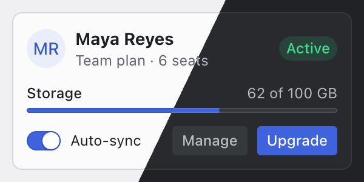

# Radix Themes

A styled component library from the makers of Radix Primitives: about 35 components (buttons, text fields, selects, menus, dialogs, tabs, tables, cards, callouts, data lists, segmented controls, sliders and more) plus layout and type components, all built on one system of 12-step colour scales, spacing, radius and type sizes. Nothing looks default, nothing shouts, and light and dark are both designed rather than inverted. You don't copy source: install one package, wrap your app in `<Theme>`, and change the whole look from its props.



| | |
|---|---|
| **By** | WorkOS |
| **Demo** | [radix-ui.com/themes/playground](https://www.radix-ui.com/themes/playground) |
| **Source** | [radix-ui/themes](https://github.com/radix-ui/themes) |
| **Licence** | MIT (keep notice): no visible credit; the licence stays inside `node_modules`. There's no paid tier; the photos in the docs' examples aren't part of the package. Read on 2026-11-12 at v3.3.0 |
| **Needs** | React 16.8 or later (18 and 19 included). No Tailwind needed: it ships its own CSS |

## Install

```bash
npm install @radix-ui/themes      # or: pnpm add @radix-ui/themes
```

Import the CSS once, at the root of your app, and wrap the app in `<Theme>`:

```tsx
import '@radix-ui/themes/styles.css';
import { Theme } from '@radix-ui/themes';

export default function RootLayout({ children }) {
  return (
    <html lang="en">
      <body>
        <Theme>{children}</Theme>
      </body>
    </html>
  );
}
```

## Use it as it comes

```tsx
import { Avatar, Badge, Box, Button, Card, Flex, Progress, Switch, Text } from '@radix-ui/themes';

<Card size="1">
  <Flex align="center" justify="between">
    <Flex align="center" gap="2">
      <Avatar size="2" fallback="MR" radius="full" />
      <Box>
        <Text as="div" size="2" weight="bold">Maya Reyes</Text>
        <Text as="div" size="1" color="gray">Team plan · 6 seats</Text>
      </Box>
    </Flex>
    <Badge color="green" radius="full">Active</Badge>
  </Flex>
  <Progress value={62} size="1" />
  <Flex gap="2">
    <Button size="1" variant="soft" color="gray">Manage</Button>
    <Button size="1">Upgrade</Button>
  </Flex>
</Card>
```

The preview above is that card at the default theme (indigo accent, automatic gray, medium radius, the system font), drawn twice with `appearance="light"` and `appearance="dark"` and split on a diagonal.

**The `<Theme>` props** change everything inside it:

| Prop | Values | What it does |
|---|---|---|
| `accentColor` | 26 scales: `indigo` (default), `blue`, `iris`, `violet`, `crimson`, `tomato`, `orange`, `amber`, `grass`, `teal`, `jade`, `gray`, `gold`, `bronze`… | the colour of buttons, focus rings, selected states, links |
| `grayColor` | `auto` (default), `gray`, `mauve`, `slate`, `sage`, `olive`, `sand` | the neutrals; `auto` picks the one that suits the accent |
| `appearance` | `inherit` (default), `light`, `dark` | `inherit` follows a `.light`/`.dark` class higher up, so it works with `next-themes` |
| `radius` | `none`, `small`, `medium` (default), `large`, `full` | corner rounding everywhere, in proportion |
| `scaling` | `90%` … `110%` | sizes and spacing for denser or roomier apps |
| `panelBackground` | `translucent` (default), `solid` | cards, menus and dialogs with or without a frosted see-through look |

Themes nest: wrap a section in another `<Theme accentColor="crimson">` to change just that part. Add `<ThemePanel />` inside `<Theme>` while you design to try every setting live.

**The best pieces:** `Button` and `IconButton` (solid, soft, surface, outline, ghost, with a built-in loading spinner), `SegmentedControl`, `TextField` with slots for icons, `Select`, `DropdownMenu` and `ContextMenu`, `Dialog` and `AlertDialog`, `Tabs` and `TabNav`, `Table`, `DataList`, `Callout`, `RadioCards` and `CheckboxCards`, `Skeleton`, `Progress`, and `Card` with `Inset` for full-bleed images.

## Use it in your brand

Radix Themes takes your brand through its own theming, not through raw colour values: every colour is a 12-step scale (backgrounds, borders, solid fills and text, plus a see-through version of each, in light and dark). One brand colour can't become those scales by a simple mapping, so this entry has no `pa add --brand` adapter. Radix's free palette tool does it properly:

1. Open [radix-ui.com/colors/custom](https://www.radix-ui.com/colors/custom). Enter your primary as **Accent**, a mid grey from your brand (your secondary text colour works) as **Gray**, and your page colour as **Background**.
2. From **Copy CSS code**, copy the accent scale, the gray scale and the background colour. Switch the tool to dark, enter your dark page colour, and copy all three again.
3. Paste them into a CSS file loaded after `@radix-ui/themes/styles.css`. The accent scale is named after its nearest hue (for a blue, `--blue-1` … `--blue-12`), so it replaces that built-in scale.
4. Point `<Theme>` at it: `<Theme accentColor="blue" grayColor="gray">`, using the name from the pasted CSS.

**Fonts** are CSS variables on `.radix-themes`:

```css
.radix-themes {
  --default-font-family: "Inter", system-ui, sans-serif;
  --heading-font-family: "Instrument Serif", Georgia, serif;
  --code-font-family: "JetBrains Mono", ui-monospace, monospace;
}
```

**Corners** take the nearest `radius`: `small` (3 px on a standard button, 6 px on a card), `medium` (4 px and 8 px, the default), `large` (6 px and 12 px), `full` for pill-shaped controls, or `none`.

Tested on 2026-11-12 with both example brands in this repo, running Radix's own palette code (the generator behind the tool) on each brand's primary, secondary text and page colours: the preview card took the `example` orange and warm greys with Inter and `radius="large"`, and the `example-cool` blue and slate on both schemes. The tool tunes its see-through steps to the page colour you give it, so cards and soft buttons look right on that page colour; on a different backdrop they can pick up a tint.

## Notes

- **Themes, not Primitives.** Radix Primitives (`@radix-ui/react-*`, unstyled) is a separate project that shadcn/ui is built on. Radix Themes is the finished, styled layer on top; you don't need shadcn or Tailwind to use it.
- It sits happily beside Tailwind if you already have it, but leave its components' own styling alone: they're themed through `<Theme>` props and the CSS variables above, not class names.
- Icons in the docs come from `@radix-ui/react-icons` (MIT), a separate install.
- Every interactive component keeps Radix Primitives' keyboard, focus and screen-reader behaviour.
- The 26 built-in scales are Radix Colors; each pairs light and dark steps tuned for contrast, so a built-in accent is the zero-effort route to a polished look.
