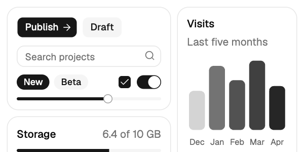

# shadcn/ui

Buttons, inputs, selects, dialogs, menus, tabs, tables, sidebars and charts with careful proportions and quiet defaults, and the base most other React kits now build on (about 128,000 GitHub stars on 12 November 2026). It isn't a package you import. A command copies each component's source into your project, so from then on it's your code, and everything reads one set of CSS variables, which is why one theme file restyles all of it. Dozens of other kits (coss ui, Kokonut UI and Launch UI among them) install through the same command.



| | |
|---|---|
| **By** | shadcn |
| **Demo** | [ui.shadcn.com](https://ui.shadcn.com) |
| **Source** | [shadcn-ui/ui](https://github.com/shadcn-ui/ui) · CLI on npm as [`shadcn`](https://www.npmjs.com/package/shadcn) |
| **Licence** | MIT (keep notice): no visible credit, but copied files must keep the MIT notice as a comment (see Install). The `shadcn` package keeps its own licence in `node_modules`. There's no paid tier. Read on 2026-11-12 at commit `dd41d19` and npm `shadcn` 4.23.0 |
| **Needs** | React 18 or 19, Tailwind CSS v4, and a project the CLI recognises (Next.js, Vite, TanStack Start, React Router, Laravel or Astro) |

## Install

Set the project up once. The CLI asks for a component base (Radix, Base UI or React Aria) and a style preset, writes `components.json`, adds the theme to your global CSS and installs what it needs (`shadcn` itself, `cn`, `class-variance-authority`, `tw-animate-css`, `lucide-react` and a font):

```bash
npx shadcn@latest init                       # or: pnpm dlx shadcn@latest init · bunx --bun shadcn@latest init
npx shadcn@latest init -b radix -p nova      # the base and preset the preview uses, without the questions
```

Then add components by name. Each lands in `components/ui/` as a file you own:

```bash
npx shadcn@latest add button card input badge switch checkbox slider progress chart
```

**Keep the MIT notice.** The CLI doesn't add one, so put this at the top of each copied file, and save the licence once next to them:

```tsx
// Based on shadcn/ui (https://ui.shadcn.com)
// Copyright (c) 2023 shadcn. MIT licence; full text in ./LICENSE.md
```

```bash
curl -sL https://raw.githubusercontent.com/shadcn-ui/ui/main/LICENSE.md -o components/ui/LICENSE.md
```

## Use it as it comes

```tsx
import { Button } from '@/components/ui/button';
import { Card, CardContent, CardDescription, CardHeader, CardTitle } from '@/components/ui/card';
import { Progress } from '@/components/ui/progress';

<Button>Publish</Button>
<Button variant="secondary">Draft</Button>

<Card size="sm">
  <CardHeader>
    <CardTitle>Storage</CardTitle>
    <CardDescription>6.4 of 10 GB</CardDescription>
  </CardHeader>
  <CardContent><Progress value={64} /></CardContent>
</Card>
```

The preview is the Radix base with the default **Nova** preset (Lucide icons, Geist, neutral greys), unedited: `Button`, `Input`, `Badge`, `Checkbox`, `Switch`, `Slider`, `Progress` and `Card`, plus `Chart` drawing a Recharts bar chart in the theme's five chart greys.

The presets change type, icons and shape, not just colour: **Nova** (Lucide, Geist), **Vega** and **Luma** (Lucide, Inter), **Maia** (Hugeicons, Figtree), **Lyra** (Phosphor, JetBrains Mono), **Mira** (Hugeicons, Inter), **Sera** (Lucide, Noto Sans with Playfair Display headings) and **Rhea** (Lucide, Inter). Pick one at `init`; [ui.shadcn.com/create](https://ui.shadcn.com/create) previews them.

**Where to start:**

| Component | What it does | Good for |
|---|---|---|
| `button`, `badge`, `input`, `select`, `textarea`, `field` | the everyday controls, with labels, descriptions and error states | every form |
| `card`, `tabs`, `separator`, `sidebar` | layout pieces | dashboards and settings pages |
| `dialog`, `sheet`, `drawer`, `popover`, `dropdown-menu`, `command` | windows and menus that open over the page, keyboard-accessible | confirmations, quick search, actions |
| `chart` | Recharts styled by the theme's `--chart-1` to `--chart-5` | area, bar, line, pie and radar charts that match the rest |
| `data-table` (a guide, built on `table`) | sorting, filtering and paging with TanStack Table | admin lists |
| blocks ([ui.shadcn.com/blocks](https://ui.shadcn.com/blocks)) | whole login pages, sidebars and dashboards | starting a screen rather than a component |

## Use it in your brand

```bash
cd your-project
pa add shadcn-ui --brand brand.json
# or read the colours straight from another project's CSS:
pa add shadcn-ui --brand path/to/globals.css
```

This installs `shadcn` (which `init` adds anyway) and writes `components/brand-theme.css`: the `:root` and `.dark` blocks of a shadcn theme in your colours, fonts and corner radius. Paste the two blocks over the ones in your global CSS, or import the file after it. Components you've already added pick it up, and so does anything you add later from shadcn or another kit that reads the same variables.

**One edit for fonts.** The theme sets `--font-sans`, `--font-heading` and `--font-mono`, but `init` writes the preset's font into Tailwind's `@theme inline` block by name, and that wins. Point those lines at the variables instead:

```css
@theme inline {
  --font-sans: var(--font-sans);        /* was 'Geist Variable', sans-serif */
  --font-heading: var(--font-heading);  /* was var(--font-sans) */
}
```

The theme names your fonts; it doesn't load them. Load them as you do now (`next/font`, `@fontsource`, a `<link>`), and drop the preset's `@fontsource-variable/geist` import if you no longer use Geist.

shadcn's `--accent` is its hover grey, not a brand colour, so a strong brand accent goes to the chart colours instead. Tested on 2026-11-12 with both example brands from this repo: colours, the dark scheme and the corner radius restyled every component straight away; the body font followed only after the `@theme inline` edit (headings switched without it).

## Notes

- Components now import `cn` from the [`cn`](https://www.npmjs.com/package/cn) package (shadcn's own, MIT) rather than a local `clsx` + `tailwind-merge` helper. Your `lib/utils.ts` re-exports it.
- `npm audit` flags two moderate advisories in the CLI's own dependencies (`deepmerge` via `@shadcn/registry`, `minimatch` via `ts-morph`). They run only when you run the CLI; nothing in them reaches your visitors. `pa check --online` tracks advisories on `shadcn` itself.
- Because the components are your files, an upstream release never changes your site. Re-run `add` with `--overwrite` only when you want a fix.
- Don't copy the docs' example photos, avatars and logos; bring your own.
