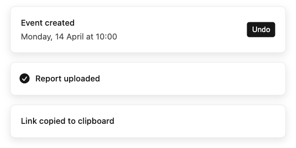

# Sonner

The toast component that set the standard. New toasts slide up from the edge, older ones tuck behind as a stack of slivers, and pointing at the stack fans it out. A loading toast can turn into a success in place, and you can swipe a toast away. It's one `<Toaster />` and a `toast()` function you call from anywhere, with no context or hooks to wire up. It's also what shadcn/ui ships as its toast. It gets about 57 million npm downloads a week (week to 11 Nov 2026).



| | |
|---|---|
| **By** | Emil Kowalski |
| **Demo** | [sonner.emilkowal.ski](https://sonner.emilkowal.ski) |
| **Source** | [emilkowalski/sonner](https://github.com/emilkowalski/sonner) |
| **Licence** | MIT (keep notice): no visible credit; the licence stays inside `node_modules`. Covers the whole package, with no paid tier. Emil's animation course on the site is a separate product that this doesn't cover or need. Read on 2026-11-12 at v2.0.8 (commit `8e4662b`, [LICENSE.md](https://github.com/emilkowalski/sonner/blob/8e4662b39255120b62138312058f5d77c0139a5e/LICENSE.md)) |
| **Needs** | React 18 or 19 |

## Install

```bash
npm install sonner      # or: pnpm add sonner
```

In a shadcn/ui project, add it through shadcn instead. That installs `sonner` (and `next-themes`) and writes a small wrapper, `components/ui/sonner.tsx`, which ties the toasts to your theme:

```bash
npx shadcn@latest add sonner
```

The styles come with the package: Sonner injects its own CSS when it loads, so there's no stylesheet to import.

## Use it as it comes

```tsx
import { Toaster, toast } from 'sonner';

// once, near the root of your app
<Toaster position="bottom-center" />

// anywhere, even outside React components
toast('Event created', {
  description: 'Monday, 14 April at 10:00',
  action: { label: 'Undo', onClick: () => undoCreate() },
});

const id = toast.loading('Uploading report.pdf…');
toast.success('Report uploaded', { id });            // replaces the loading toast in place
toast.promise(save(), { loading: 'Saving…', success: 'Saved', error: 'Could not save' });
```

The preview runs the `Event created` and upload calls above, plus `toast('Link copied to clipboard')`, on a stock `<Toaster position="bottom-center" />` at phone width. Below 600 px, toasts span the screen. Each toast has `duration: Infinity` so the stack stays up long enough to hover. A real mouse drives the fan-out, and `toast.dismiss()` clears the stack.

| Option | What it does |
|---|---|
| `position` | `top-left`, `top-center`, `top-right`, `bottom-left`, `bottom-center` or `bottom-right` (the default) |
| `expand` | keep the stack fanned out instead of collapsed |
| `richColors` | tinted green, blue, amber and red backgrounds for `success`, `info`, `warning` and `error` |
| `closeButton` | an × on each toast |
| `theme` | `light` (the default), `dark` or `system` |
| `visibleToasts`, `duration`, `gap` | defaults: 3 toasts, 4 seconds, 14 px |
| `toast.custom(jsx)`, `unstyled` | your own markup with Sonner's stacking and motion |

The details are already handled. Timers pause while you hover and while the tab is hidden. The stack is an `aria-live` region, and Alt+T jumps to it. Swipe works on touch, and motion turns off for people who ask for reduced motion.

## Use it in your brand

Sonner's stylesheet reads its colours from CSS variables (`--normal-bg`, `--normal-text`, `--normal-border`) and its corners from `--border-radius`. shadcn/ui's wrapper points those at its theme: surface → `--popover`, text → `--popover-foreground`, hairline → `--border`, corners → `--radius`. So in a shadcn/ui project, `pa add shadcn-ui --brand brand.json` already restyles your toasts, light and dark, and you don't need anything from this entry.

Everywhere else, this does the same job:

```bash
cd your-project
pa add sonner --brand brand.json
```

It installs `sonner` and writes three files to `components/`:

- `brand-theme.css`: your brand as shadcn theme variables, the same file `pa add shadcn-ui` writes. Skip this one if your CSS already has that theme.
- `brand-toaster.js` and `brand-toaster.d.ts`: `<BrandToaster>`, which is Sonner's `<Toaster>` with the four variables above pointed at that theme, plus your sans font. It takes every `<Toaster>` prop.

```tsx
// once, in your global CSS:  @import "./components/brand-theme.css";
import { BrandToaster } from '@/components/brand-toaster';
import { toast } from 'sonner';

<BrandToaster theme="system" />
```

Toasts take your background as their surface, your foreground as text, your border colour, your corner radius and your sans font. Your primary isn't used, because Sonner has no brand-coloured part. Its action button is the text colour inverted, and that stays. Rich colours stay Sonner's own green, blue, amber and red, since they mean success and failure. Because the toast surface is your page background, toasts are set off by their border and shadow, the way Sonner's white-on-white ones are.

**Dark pages.** `brand-theme.css` switches on a `.dark` class on `<html>`. Set `theme` to match (`dark`, or `system` if your class follows the OS), because Sonner still picks its description grey and its cancel-button tint from `theme`.

Tested on 2026-11-12 with both example brands in this repo, light and dark: the stack in the preview took each brand's surface, text, border, 8 or 10 px corners and Inter. The generated `.d.ts` type-checks under `tsc --strict`.

## Notes

- **Check these on upgrade.** `brand-toaster.js` only passes Sonner's `style` prop, but the four variable names it sets (`--normal-bg`, `--normal-text`, `--normal-border`, `--border-radius`) aren't in Sonner's docs. They're read by its stylesheet, and shadcn/ui's wrapper relies on them too, so they're unlikely to change. `pa check --online` flags each new version so they can be re-checked.
- If you've already run `pa add shadcn-ui --brand` (or another entry that writes `brand-theme.css`), `pa add sonner --brand` stops rather than overwrite it. Add `--force`; the file comes out the same for the same brand.
- `useSonner()` gives you the live list of toasts, for building your own display. `toast.getToasts()` returns the active ones, and `toast.getHistory()` returns up to the last 100 toasts, dismissed ones included.
- Last push 2026-08-10. The project is mature and widely depended on (it's the toast in shadcn/ui), so a quiet spell isn't a worry.
