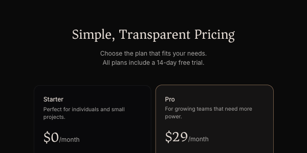

# Tailark

Marketing sections for shadcn/ui: heroes, feature grids, pricing tables, plan comparisons, stats, testimonials, FAQs, contact, log-in and sign-up forms, footers, and whole landing pages. They come in three kits with their own character: **Mist** (crisp white, one strong colour), **Dusk** (dark and quiet) and **Veil** (warm paper with serif headings). Spacing, type sizes and borders are tuned with unusual care, and every colour comes from your shadcn theme, so a block arrives already in your brand. It's copy-and-paste: the shadcn CLI drops each block's source into your project, and from then on it's your code.



| | |
|---|---|
| **By** | Méschac Irung |
| **Demo** | [tailark.com](https://tailark.com) (free kits: [oss.tailark.com](https://oss.tailark.com)) |
| **Source** | [tailark/blocks › registry/bases](https://github.com/tailark/blocks/tree/main/registry/bases) |
| **Licence** | MIT (keep notice): no visible credit, but copied files must keep the MIT notice as a comment (see Install). **Covers the free kits only:** Mist, Dusk and Veil blocks, their OSS landing pages and UI parts, from the public repo and the `@tailark-oss` registry. **Not covered:** Tailark Pro (the Quartz kit, the illustrations and the full page templates on [tailark.com](https://tailark.com/pricing), sold under a separate paid licence and served from the `@tailark` registry with an API key), and the demo content inside the free blocks: hot-linked Unsplash and Pexels photos, GitHub profile pictures of real people, Tailark's own screenshots and wordmark, and real companies' logos. Read on 2026-11-12 at commit `8139698` |
| **Needs** | A shadcn/ui project (React 18+, Tailwind CSS v4, `components.json`, a `cn()` helper), `lucide-react`; many blocks import `next/link` |

## Install

Add the free registry to your project's `components.json`. Pick the address that matches how your shadcn project was set up: Radix (most existing projects) or Base UI.

```json
{
  "registries": {
    "@tailark-oss": "https://oss.tailark.com/r/radix/{name}"
  }
}
```

For a Base UI project use `"https://oss.tailark.com/r/{name}"`. Then add blocks by name, `<kit>-<section>-<number>`:

```bash
npx shadcn@latest add @tailark-oss/veil-pricing-1      # or: pnpm dlx shadcn@latest add …
npx shadcn@latest add @tailark-oss/mist-stats-1 @tailark-oss/dusk-features-1
```

The full list is at [oss.tailark.com/r/radix/registry.json](https://oss.tailark.com/r/radix/registry.json). Each block lands in `components/` (for example `components/pricing-1.tsx`), and the kit's own button, card and inputs land in `components/ui/`.

**Keep the MIT notice.** The CLI doesn't add one, so put this at the top of each copied file, and save the licence once next to them:

```tsx
// Based on Tailark (https://tailark.com) by Méschac Irung.
// Copyright (c) 2025 Irung. MIT licence; full text in ./TAILARK-LICENCE.md
```

```bash
curl -sL https://raw.githubusercontent.com/tailark/blocks/main/LICENCE.md -o components/TAILARK-LICENCE.md
```

## Use it as it comes

```tsx
import Pricing from '@/components/pricing-1';
import Stats from '@/components/stats-1';

export default function Page() {
  return (
    <main>
      <Pricing />
      <Stats />
    </main>
  );
}
```

Blocks take no props: edit the copy, prices and lists in the file. They're responsive (some use container queries, so they adapt to the column they sit in, not only the screen) and follow your `.dark` class.

The preview above is `veil-pricing-1` unedited, cropped to its top, in Tailark's own Veil palette with the `.dark` class on, rendered from the registry at 0.75 scale. The kit palettes you see on tailark.com aren't installed with the blocks; they live in the repo's [`app/globals.css`](https://github.com/tailark/blocks/blob/main/app/globals.css) under `[data-theme="mist"]` and `[data-theme="veil"]` (Dusk is its `:root`). Copy one into your own `:root` and `.dark` if you want a kit's exact look. Note that Veil's light scheme there reads `--foreground` from Dusk's `:root`, so its muted surfaces and borders come out invisible on Tailark's own site; set them yourself if you copy it.

**Good places to start** (none of these carry demo photos or logos):

| Block | What it is |
|---|---|
| `veil-pricing-1`, `mist-pricing-2`, `dusk-pricing-2` | plan cards with a highlighted plan |
| `veil-comparator-1` | a plan-by-feature comparison table |
| `veil-stats-2` | three headline figures over a field of rising hairlines |
| `mist-stats-1` | three big figures in one divided card |
| `veil-faqs-1`, `mist-faqs-2` | an accordion of questions |
| `veil-contact-1` | a contact form with labels, inputs and a full-width button, beside the contact details |
| `dusk-features-1`, `mist-features-4` | feature cards illustrated with drawn panels and small interface mock-ups |

The log-in and sign-up blocks (`veil-login-1`, `mist-sign-up-1`…) are as well made but come with the kit's logo and "Continue with Google" buttons to swap or wire up. Dusk also has ten whole landing pages (`dusk-landing-1` … `dusk-landing-10`) assembled from its sections, logo clouds and demo media included.

## Use it in your brand

Every block colours itself from shadcn's theme variables (`bg-background`, `text-foreground`, `text-muted-foreground`, `bg-card`, `bg-primary`, `ring-primary`, `border`), and the corners follow `--radius`. So the brand step is your shadcn theme:

```bash
cd your-project
pa add tailark --brand brand.json
# or read the colours straight from your shadcn / Tailwind CSS:
pa add tailark --brand src/app/globals.css
```

This writes `components/brand-theme.css`: the `:root` and `.dark` blocks of a shadcn `globals.css` in your colours, fonts and corner radius. Paste them over the ones in your `globals.css`, or `@import` the file after it. Blocks added before or after pick it up; there's nothing to re-generate per block.

Two kit habits to know:

- **Veil's buttons are ink, not brand colour.** Its main button is `bg-foreground`, so your primary shows on the highlighted plan's ring, the ticks and links. Mist's and Dusk's main buttons are `bg-primary`.
- **Veil's headings and prices use `font-serif`.** To set them in your display font, add `--font-serif: var(--font-heading);` to the `@theme inline` block of your `globals.css`. Without it they fall back to Tailwind's default serif.

Tested on 2026-11-12 with both example brands in this repo: `veil-pricing-1` took the `example-cool` background, ink, blue ring and 8 px corners on its light and dark schemes, and with the line above, `example` set the headline and prices in Instrument Serif with an orange ring.

## Notes

- **Bring your own pictures and logos.** The free blocks hot-link demo photos from Unsplash and videos from Pexels, use GitHub profile pictures of real people as testimonial avatars, point at screenshots that live on Tailark's own site (`/mail2.png`, `/mist/tailark.png`…), and ship logo clouds of real companies (`components/ui/svgs/`). None of that is yours to ship: swap them all before you publish.
- **Replace the kit's `Logo`.** Headers, footers and the log-in and sign-up blocks draw the kit's `Logo` (installed as `components/logo.tsx`), which is Tailark's own wordmark. Swap in yours, or the page carries their name.
- **Each kit brings its own `components/ui/button.tsx`, `card.tsx` and inputs**, and they replace shadcn's stock ones of the same name (the CLI won't overwrite them unless you confirm or pass `--overwrite`). Mixing kits in one project means one kit's button wins; stick to one kit per project or rename the files.
- **Not on Next.js?** Many blocks `import Link from 'next/link'`. Swap it for a plain `<a>` or your router's link.
- Some blocks also pull in Motion-Primitives (`text-effect`, `animated-group`, `infinite-slider`, `progressive-blur`) and Magic UI's `border-beam`, both MIT, plus the `motion` package. The CLI installs them; they need the same notice treatment.
- A few illustration-heavy Dusk and Mist feature blocks hard-code Tailwind greys and accent colours inside their drawings; those don't follow your theme.
- The repo's README gives the registry address as `oss-tailark.com`, which didn't resolve on 2026-11-12; `oss.tailark.com` (from tailark.com/docs) is the working one.
