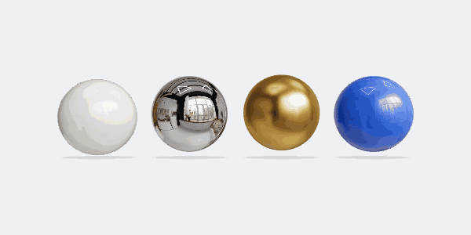

# three.js

The library nearly every 3D thing on the web is built on, with 116,000 GitHub stars. It puts a real-time 3D scene in a canvas: physically based materials (metal, glass, lacquer, fabric, iridescent film), lighting and reflections from a single HDRI, glTF models straight out of Blender, shadows, and post-processing such as bloom and depth of field. Because every frame is drawn from code, a scene can also be stepped frame by frame and captured as video. It's the bridge between the [Poly Haven](../poly-haven) assets in this catalogue and a moving, interactive picture.



| | |
|---|---|
| **By** | Ricardo Cabello (mrdoob) and contributors |
| **Demo** | [threejs.org/examples](https://threejs.org/examples/) (hundreds, each with its source) |
| **Source** | [mrdoob/three.js](https://github.com/mrdoob/three.js) |
| **Licence** | MIT (keep notice): no visible credit; the licence stays inside `node_modules`. Read on 2026-10-15 at r186 (0.186.1) |
| **Needs** | WebGL 2 (every current browser); WebGPU optionally, through `three/webgpu` |

## Install

```bash
npm install three      # or: pnpm add three
```

In React, [React Three Fiber](https://r3f.docs.pmnd.rs/) (`@react-three/fiber`, MIT) writes the same scene as components, and its helper library `@react-three/drei` adds ready-made cameras, environment lighting, text and loaders.

## Use it as it comes

The preview, minus the bobbing: four spheres under a Poly Haven studio HDRI, with the environment turning so the reflections move.

```js
import * as THREE from 'three';
import { HDRLoader } from 'three/addons/loaders/HDRLoader.js';

const renderer = new THREE.WebGLRenderer({ antialias: true });
renderer.toneMapping = THREE.ACESFilmicToneMapping;
const scene = new THREE.Scene();
const camera = new THREE.PerspectiveCamera(30, width / height, 0.1, 100);
camera.position.set(0, 0.35, 7.2);

const hdr = await new HDRLoader().loadAsync('/brown_photostudio_02_1k.hdr');   // from Poly Haven
hdr.mapping = THREE.EquirectangularReflectionMapping;
scene.environment = hdr;                       // all the light and every reflection

const ball = new THREE.SphereGeometry(0.62, 96, 64);
scene.add(new THREE.Mesh(ball, new THREE.MeshPhysicalMaterial({ metalness: 1, roughness: 0.04 })));       // chrome
scene.add(new THREE.Mesh(ball, new THREE.MeshPhysicalMaterial({ color: '#2563eb', roughness: 0.35, clearcoat: 1 })));   // lacquer

renderer.setAnimationLoop((ms) => {
  scene.environmentRotation.y = ms / 6000 * Math.PI * 2;
  renderer.render(scene, camera);
});
```

Before you write anything, find the nearest [official example](https://threejs.org/examples/) and start from its source.

**For video.** Drive the scene from a frame number instead of the clock (`environmentRotation.y = frame / total * 2π`), render, and capture each frame. Create the renderer with `preserveDrawingBuffer: true` if you read pixels back from the canvas.

## Use it in your brand

There's no adapter. Brand colours go straight into materials (`color: '#2563eb'`), and type into 3D with `TextGeometry` (your font converted to three's typeface JSON, for example with facetype.js), or into the page over the canvas. What makes a scene feel like your brand is mostly the light: a warm studio HDRI for a warm palette, an overcast sky for a cool one ([Poly Haven](../poly-haven) has both).

## Notes

- **`RGBELoader` is now `HDRLoader`.** It was renamed in r180; the old name still works but warns. Most tutorials still show the old name.
- three.js releases monthly, and minor versions do break things now and then. Pin the version, and check the [migration guide](https://github.com/mrdoob/three.js/wiki/Migration-Guide) before upgrading.
- The preview's lighting is Poly Haven's *Brown Photostudio 02* HDRI, CC0. The spheres are three's own `MeshPhysicalMaterial`, untextured.
- For photoreal stills, Blender's Cycles renderer is slower but more accurate. three.js wins when the picture has to move, respond, or render in a browser.
