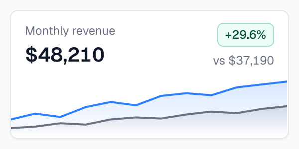

# Tremor

Dashboard components for React and Tailwind, with the restraint of a good analytics product: area, bar, line, combo, doughnut and spark charts, bar lists, category bars, progress bars and rings, uptime-style trackers, KPI cards and badges, plus the controls a dashboard needs around them (buttons, tabs, selects, date pickers, dialogs, drawers, toasts). The charts are built on Recharts but look nothing like stock Recharts: thin lines, soft gradients, quiet axes and a considered dark mode. It's copy-and-paste, like shadcn/ui: you copy each component's source into your project, and from then on it's your code.



| | |
|---|---|
| **By** | Tremor Labs (Severin Landolt, Christopher Kindl); part of Vercel since January 2025 |
| **Demo** | [tremor.so/docs](https://tremor.so/docs) |
| **Source** | [tremorlabs/tremor › src/components](https://github.com/tremorlabs/tremor/tree/main/src/components) |
| **Licence** | Apache-2.0 (keep notice): no visible credit, but copied files must keep a notice, say that you changed them, and come with a copy of the licence (see Install). The licence file also lists a few MIT parts (from Radix, shadcn/ui, Radix Themes and Medusa), which the same notice covers. This entry is the copy-and-paste components ("Tremor Raw"), not the older `@tremor/react` npm package, which hasn't been pushed to since January 2025. Read on 2026-11-12 at commit `ca4d588` |
| **Needs** | React 18.2+, Tailwind CSS v4, `recharts` 2 for the charts, `@remixicon/react` 4.8.0 for icons, Radix primitives for most controls |

## Install

Install the shared dependencies, plus `recharts` for the charts:

```bash
npm install tailwind-variants clsx tailwind-merge @remixicon/react@4.8.0 recharts@2   # or: pnpm add …
npm install -D @tailwindcss/forms
```

**Pin Remix Icon at 4.8.0.** Tremor's icons (chevrons, close, check, calendar, spinner) come from `@remixicon/react`. Up to 4.8.0 it's Apache-2.0; from 4.9.0 (January 2026) it's the custom "Remix Icon License 1.0", which still needs no credit but isn't one of this catalogue's licences: it bars using an icon as a logo or app icon and selling the icons as a set. 4.8.0 has every icon Tremor uses. Or swap the handful of `Ri…` icons for `lucide-react` ones.

Then follow the [Next.js setup](https://tremor.so/docs/getting-started/installation/next) once: it adds `@plugin "@tailwindcss/forms"`, the `dark` variant and Tremor's animation keyframes to your `globals.css`, and creates `lib/utils.ts` (`cx`, `focusRing`, `focusInput`, `hasErrorInput`) and `lib/chartUtils.ts`. After that, open a component's page (for example [Area Chart](https://tremor.so/docs/visualizations/area-chart)), install the extra package it names, and paste its code into `components/`. The pasted code imports from `@/lib/utils` and `@/lib/chartUtils`; fix those paths if your project differs. The same files are in the repo's `src/components/`, with relative imports.

**Keep the notice and mark your changes.** Apache-2.0 asks for three things when you ship the code: keep a notice, say that you changed a file (fixing the import paths counts), and include the licence. Put this at the top of each copied file:

```tsx
// Based on Tremor (https://tremor.so), copyright Tremor Labs, Inc.
// Apache License 2.0; full text in ./TREMOR-LICENSE. Changed from the original.
```

```bash
curl -sL https://raw.githubusercontent.com/tremorlabs/tremor/main/LICENSE -o components/TREMOR-LICENSE
```

Tremor ships no `NOTICE` file, so there's nothing else to carry.

## Use it as it comes

```tsx
import { AreaChart } from '@/components/AreaChart';
import { Badge } from '@/components/Badge';
import { Card } from '@/components/Card';

const data = [
  { month: 'Jan', 'This year': 31200, 'Last year': 27400 },
  { month: 'Feb', 'This year': 33900, 'Last year': 28100 },
  // …
];

<Card className="p-4">
  <p className="text-sm text-gray-500">Monthly revenue</p>
  <p className="text-2xl font-semibold text-gray-900 dark:text-gray-50">$48,210</p>
  <Badge variant="success">+29.6%</Badge>
  <AreaChart
    className="h-40"
    data={data}
    index="month"
    categories={['This year', 'Last year']}
    colors={['blue', 'gray']}
    valueFormatter={(n) => `$${(n / 1000).toFixed(1)}k`}
  />
</Card>
```

The preview above is `Card`, `Badge` and `AreaChart` copied unedited from the repo, set in Geist (the font Tremor's docs use). Only props and classes changed: the chart's axes, grid, legend and tooltip are off, `minValue`/`maxValue` keep the lines in frame, and the card's padding moves to the header so the chart runs edge to edge.

**The best pieces:**

| Component | What it does | Good for |
|---|---|---|
| `AreaChart`, `LineChart`, `BarChart` | multi-series charts with a legend and a tooltip; areas in gradient, solid or no fill; stacked and percent modes for areas and bars | the main chart on a dashboard |
| `ComboChart` | bars and a line, optionally on two axes | volume against rate |
| `DonutChart` | a doughnut (with a label in the middle) or a pie | a share at a glance |
| `SparkAreaChart`, `SparkLineChart`, `SparkBarChart` | axis-free mini charts | a trend inside a table row or KPI card |
| `BarList` | a ranked list with proportional bars behind each row | top pages, top sources |
| `CategoryBar` | one bar split into coloured ranges, with a marker | a score against thresholds |
| `ProgressBar`, `ProgressCircle` | quiet progress, with a label beside the bar or a figure inside the ring | quotas, goals |
| `Tracker` | a strip of small blocks, one per day or check | uptime, streaks |
| `Card`, `Badge`, `Callout`, `Table` | the frame around the numbers | KPI tiles, status, data tables |

## Use it in your brand

Tremor has no theme file: its colours are Tailwind classes written into each component, mostly the `blue` and `gray` palettes, with `white` and a near-black (`#090E1A`) for cards. That's why this entry has no `pa add --brand` adapter. A one-colour brand can't honestly become Tremor's eleven-step blues and greys, and redefining Tailwind's `blue` and `gray` would recolour the rest of your site too. Since the files are yours, the brand step is a small edit:

**Charts.** Add your colours to `chartColors` in `lib/chartUtils.ts`, then pass them by name:

```css
/* globals.css */
@theme {
  --color-brand: #E4572E;
}
```

```ts
// lib/chartUtils.ts, inside chartColors
brand: { bg: "bg-brand", stroke: "stroke-brand", fill: "fill-brand", text: "text-brand" },
```

```tsx
<AreaChart colors={['brand', 'gray']} … />
```

Everything that reads `chartColors` follows: lines, area fills, bars, and the legend and tooltip dots. Tested on 2026-11-12 with the `example` brand's orange: the line and its gradient fill took it.

**Controls.** Tremor's accent is Tailwind's `blue-500` (buttons, switches, checkboxes, radios, sliders, tabs, progress, focus rings), with a few lighter and darker blues for soft and hover states, across 17 components plus `focusRing` and `focusInput`. Either:

- swap `blue-` for your own colour's name in the copied files and define that colour's 50–950 steps in `@theme`, or
- if nothing else on your site uses Tailwind's blue, redefine `--color-blue-50` … `--color-blue-950` in `@theme` to your brand's steps.

**Surfaces and text** are Tailwind's `gray` (cool) plus `white` and `#090E1A`. To warm them, swap `gray-` for `stone-` or `neutral-` in the copied files.

**Fonts** come from the page: the components set sizes and weights but no typeface. **Corners** are Tailwind's `rounded-sm`, `rounded-md` and `rounded-lg`, so redefining `--radius-sm`, `--radius-md` and `--radius-lg` in `@theme` reshapes them (and the rest of your Tailwind site).

## Notes

- **Tremor Blocks and templates are free too.** Since joining Vercel, Tremor made its once-paid [Blocks](https://blocks.tremor.so) (whole dashboard sections and pages built from these components) free under MIT. They're a good source of layouts, but bring your own logos and pictures.
- **The charts use Recharts 2**, which Recharts now calls inactive in favour of v3. Tremor's charts haven't been ported to v3 yet, so keep `recharts@2` for them.
- **The repo is quiet.** Its last push was October 2025. The components are self-contained once copied, so a slow upstream doesn't break your site, but there's little new coming.
- Dark mode follows a `.dark` class on a parent (the setup adds `@custom-variant dark (&:where(.dark, .dark *))`).
- The menus, dialogs, drawers, selects, tabs, switches, checkboxes, sliders, tooltips and toasts are built on Radix primitives (`@radix-ui/react-*`), so keyboard and screen-reader behaviour comes with them. The date picker uses React Aria and `react-day-picker`.
