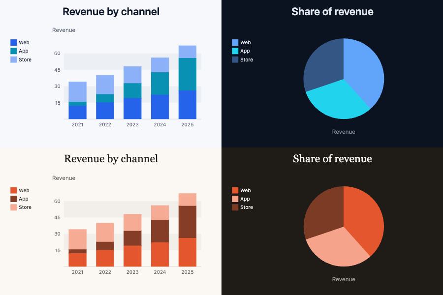

# Vizzu

Charts that turn into other charts. Change what's on each axis and Vizzu animates every bar, slice and area from the old view to the new one: stacked bars split into groups, bend round into a pie, then pour into stacked areas, and the viewer can follow each piece of data the whole way. That makes it the tool for a data story told in steps, in a talk, a scrolling page or a few seconds of video. The engine is C++ compiled to WebAssembly and draws on a canvas.


| | |
|---|---|
| **By** | Vizzu |
| **Demo** | [lib.vizzuhq.com](https://lib.vizzuhq.com) (tutorial, examples and showcases) |
| **Source** | [vizzuhq/vizzu-lib](https://github.com/vizzuhq/vizzu-lib) |
| **Licence** | Apache-2.0 (keep notice): no visible credit; keep the LICENSE file with the code, which npm does inside `node_modules`. The small Vizzu logo it draws in the corner is not a licence condition, and the library's own tutorial shows how to switch it off. Read on 2026-10-15 at v0.18.0 |
| **Needs** | A browser with WebAssembly. Any JavaScript project; no framework needed |

## Install

```bash
npm install vizzu      # or: pnpm add vizzu
```

Vizzu loads its engine, `cvizzu.wasm`, from the folder its script was loaded from. A bundler doesn't copy it for you: copy `node_modules/vizzu/dist/cvizzu.wasm` to your public folder and point Vizzu at it before the first chart.

```js
import Vizzu from 'vizzu';
Vizzu.options({ wasmUrl: '/cvizzu.wasm' });
```

Without this the chart stays blank and the console says "both async and sync fetching of the wasm failed".

## Use it as it comes

Data goes in once, as named series. Each `animate` call then describes the next chart, and Vizzu works out the motion between them.

```js
const data = { series: [
  { name: 'Year', type: 'dimension', values: ['2024', '2025', '2024', '2025'] },
  { name: 'Channel', type: 'dimension', values: ['Web', 'Web', 'App', 'App'] },
  { name: 'Revenue', type: 'measure', values: [22, 26, 21, 30] },
]};

const chart = new Vizzu('chart', { data });          // the id of a div with a size
await chart.initializing;
chart.on('logo-draw', (event) => event.preventDefault());    // no logo

await chart.animate({ config: { x: 'Year', y: ['Channel', 'Revenue'], color: 'Channel' } });   // stacked bars
await chart.animate({ config: { x: ['Year', 'Channel'], y: 'Revenue' } }, '0.9s');           // grouped
await chart.animate({ config: { x: ['Channel', 'Revenue'], y: null, coordSystem: 'polar' } }, '1.2s');   // pie
await chart.animate({ config: { x: 'Year', y: ['Channel', 'Revenue'], coordSystem: 'cartesian', geometry: 'area' } });
```

The moves worth knowing: putting a dimension next to a measure on one axis stacks it; moving it to the other axis groups it; `coordSystem: 'polar'` bends whatever is there into a circle; `geometry` switches between `rectangle`, `area`, `line` and `circle`; `filter` animates data in and out. The [preset charts](https://lib.vizzuhq.com/latest/examples/presets/) cover the common shapes by name.

**For video.** Every `animate` returns a promise and takes a duration, and the timeline can be scrubbed (`chart.animate(...).activated.then(c => c.seek('50%'))`), so a renderer can step through a sequence frame by frame.

## Use it in your brand

```bash
pa add vizzu --brand src/app/globals.css     # or a brand .json
```

This writes `brand-vizzu.js` (+ `.d.ts`) into `src/components/`: `brandStyle.light` and `brandStyle.dark`, which are full Vizzu style sheets, and `brandChart(chart, theme)`, which applies one with no animation and switches the logo off.

```js
import Vizzu from 'vizzu';
import { brandChart } from './components/brand-vizzu';

const chart = new Vizzu('chart', { data });
await chart.initializing;
await brandChart(chart);                  // or brandChart(chart, 'dark')
await chart.animate({ config: { x: 'Year', y: 'Revenue', color: 'Channel' } });
```

| Vizzu style | From your brand |
|---|---|
| Series colours (`plot.marker.colorPalette`) | primary, then accent (or primary deepened toward your text colour when the accent is too close to it), then lighter and darker steps of both, then muted text |
| A measure on colour (`colorGradient`) | a pale tint of primary, through primary, to primary deepened toward your text |
| Background, legend labels, marker labels | background and text colour |
| Axis labels and titles, subtitle, caption | muted text |
| Axis lines and ticks; the alternating bands | border; the background tinted toward muted |
| Fonts | sans for everything; titles in your display face at its own weight (semibold when there's no separate display face) |
| Tooltip | inverted: text colour behind background-coloured type |



<sub>`pa add vizzu --brand brands/example-cool.json` (top) and `brands/example.json` (bottom): light on the left, dark on the right.</sub>

Anything you set in a later `animate({ style })` overrides the brand sheet, so tweak per chart without editing the generated file.

## Notes

- Vizzu draws on a canvas, so its type is canvas text: load your web fonts before the first chart (`await document.fonts.ready`) or the first frame draws in the fallback.
- **TypeScript.** Vizzu 0.18's types don't accept the short forms its own docs use (`{ config: { x: 'Year' } }`, or a series name as a string): under `tsc --strict` they fail, though they run fine. Until that's fixed upstream, loosen the type at the call (`chart.animate({ config: { x: 'Year' } } as any)`). The generated `brand-vizzu.d.ts` uses Vizzu's own `Styles.Chart` type and passes `tsc --strict`.
- The preview shows Vizzu's own colours and fonts; the only change from stock is the logo switched off.
- The last release was 0.18.0 in April 2026. It's maintained by a small company and moves slowly but steadily; pin the version.
